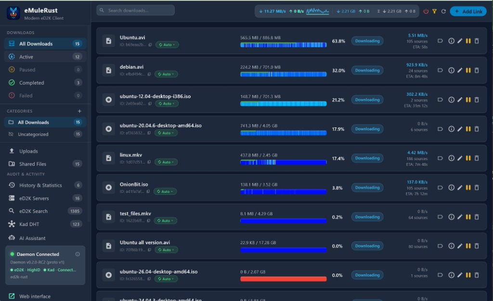

<div align="center">


# eMuleRust

**A modern, security-hardened reimplementation of the eD2K and Kad (Kademlia) peer-to-peer protocols — Rust engine, Flutter desktop UI, native MCP server for AI agents.**

[](LICENSE)
[](https://github.com/laurentgeynet-ux/eMule-Rust/actions/workflows/ci.yml)
[](https://github.com/laurentgeynet-ux/eMule-Rust/releases)
[](README.md)

[🇫🇷 Version française](README.fr.md)

</div>

---

## Overview

eMuleRust is an independent, ground-up reimplementation of the historic **eD2K (eDonkey2000)** and **Kad DHT (Kademlia)** protocols, faithful to the eMule 0.72a reference. The engine is written in **Rust** (sparse storage engine, async Tokio daemon, bounded wire codecs, dynamic swarm allocator) and the interface in **Flutter Desktop** (reactive native Windows UI, Clean Architecture MVVM).

> **Disclaimer** — eMuleRust is an independent project. It is **not affiliated with, endorsed by, or connected to** the eMule project (emule-project.net) or the Rust Foundation. « Rust » refers to the implementation language. See [`NOTICE`](NOTICE) for full attribution.

## Screenshot



*Real-network session: HighID on eD2K, Kad connected, parallel multi-source downloads with per-part progress map.*

## Key Features

- **Safe, modern Rust engine** — 100% memory safe, bounded wire framing, streaming zlib decompression (`OP_COMPRESSEDPART`), zero uncontrolled allocation.
- **Autonomous multi-source swarm** — *Weighted Max-Min Fair-Share* (water-filling) algorithm distributing connection slots by file rarity and priorities.
- **Kademlia v2 DHT** — 128-bit numeric distance metric matching eMule's `CUInt128`, LRU-cached K-buckets, iterative lookup converging on `SEARCHTOLERANCE`.
- **Native MCP server** — **87 MCP tools** letting AI assistants (Claude Desktop, Cursor, Antigravity) drive the client end-to-end.
- **Local AI assistant** — loopback LLM orchestrator with MCP tool profiles, embedded in the desktop UI.
- **Defense-in-depth security** — 7-stage anti-SSRF pipeline, loopback isolation by default, atomic kill switch, `ipfilter.dat` IP filtering, salted peer pseudonymization.
- **eMule protocol fidelity** — validated against the official **eMule 0.72a** sources (`srchybrid`), Source Exchange v4 (SX1/SX2), fine-grained remote queue ranking.
- **Portable mode** — `portable.flag` beside the executable keeps all state inside the bundle (`data/` + `downloads/`); installed mode uses `%LOCALAPPDATA%\eMuleRust`.

## Quick Start

### Download

Grab the latest `eMuleRust-v*-standard-windows-x64.zip` from [**Releases**](https://github.com/laurentgeynet-ux/eMule-Rust/releases), unzip, run `eMuleRust.exe`. Every release ships `SHA256SUMS.txt` and a CycloneDX SBOM.

### Prerequisites (build from source)

- Windows 10/11 (x64)
- Rust 1.80+ (stable)
- Flutter 3.24+ (Windows desktop enabled)
- Visual Studio C++ Build Tools 2022

### Build the portable Windows bundle

```powershell
powershell -NoProfile -ExecutionPolicy RemoteSigned -File scripts\build_windows_release.ps1
# Self-contained bundle in dist\eMuleRust-Standard-Windows\
```

### Validation (100% offline, fully reproducible)

```powershell
# Rust — lint
cargo check --workspace --all-targets --all-features
cargo clippy --workspace --all-targets --all-features -- -D warnings

# Rust — full test suite (204+ unit & integration tests, loopback only)
cargo test --workspace --all-features

# Flutter — analysis and tests
cd apps/desktop
flutter analyze
flutter test
```

## Repository Layout

| Path | Role |
| :--- | :--- |
| `crates/mule-protocol` | eD2K/Kad wire codecs, opcodes, framing — reference: eMule 0.72a sources |
| `crates/mule-daemon` | Tokio services: `kad`, `kad_udp`, `peer_session`, `inbound_listener`, swarm allocator |
| `crates/mule-core` / `mule-crypto` / `mule-filter` | Domain model, MD4/eD2K hashing, `ipfilter.dat` |
| `crates/mule-network-policy` | Anti-SSRF pipeline, loopback isolation, kill switch |
| `crates/mule-mcp` / `mule-assistant` | MCP server (87 tools) and local AI assistant |
| `packages/app_shell`, `mule_client`, `ui_kit` | Flutter packages: UI shell (MVVM), daemon client, design system |
| `apps/desktop`, `apps/web` | Flutter applications |
| `docs/` | Full documentation — specs, ADRs, walkthroughs, QA (mostly 🇫🇷) |

## Documentation

| Section | Contents |
| :--- | :--- |
| 📖 [Documentation Portal](docs/README.md) | Main entry point and navigation |
| 🧭 [Phase Walkthroughs](docs/walkthroughs/README.md) | Execution, interoperability and validation guides |
| 🏗️ [Architecture Report](docs/architecture/rapport_architecture_et_avancement.md) | Technical status and modular architecture |
| 🗺️ [File Map](docs/INDEX.md) | Exhaustive inventory of every file in the repo |
| 📝 [Changelog](docs/CHANGELOG.md) | Version history and fixes |
| 🔌 [eD2K Specs & ADRs](docs/ed2k/) | Wire framing, opcode catalog, design decisions |
| 🧪 [QA & Tests](docs/qa/) | Acceptance protocol, compatibility matrix, test vectors |

## Security

eMuleRust treats its network-facing surface as hostile by default. Please report vulnerabilities **privately** via [GitHub Security Advisories](../../security/advisories) — never in a public issue. See [`SECURITY.md`](SECURITY.md).

## Contributing

Contributions are welcome — see [`CONTRIBUTING.md`](CONTRIBUTING.md). Note that the codebase and documentation are written in **French**; pull requests must keep the workspace warning-free (`-D warnings`) and all tests offline (loopback only).

## License & Credits

Distributed under **GPL-2.0-or-later** — see [`LICENSE`](LICENSE), [`AUTHORS`](AUTHORS) and [`NOTICE`](NOTICE).

Protocol fidelity is based on the study of the open-source **eMule** (© 2002–2026 Merkur / eMule Dev Team) and **aMule** (© aMule Team, Angel Vidal, Barry Dunne) projects, both GPL-2.0+. File-by-file provenance: [`docs/ed2k/references.md`](docs/ed2k/references.md).

Developed by **Laurent Geynet "Loulach"** (<Dev.iptvmediacenter@gmail.com>).
