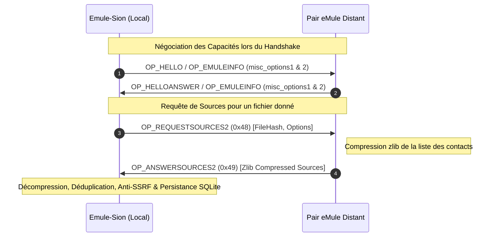

# Guide d'Exécution & Validation — Phase 13 : Source Exchange v4, Blocs Compressés & Serveur Agent IA (MCP)

Ce document constitue le guide technique de référence pour la **Phase 13** (version `v0.1.6`) du projet **Emule-Sion**, caractérisée par l'achèvement de l'interopérabilité pair-à-pair avancée et l'ouverture aux agents autonomes :
* **Source Exchange v4 (SX1 & SX2)** : Protocole décentralisé d'échange de sources entre pairs sans intermédiaire serveur, avec compression zlib et négociation de version via `misc_options1`.
* **Streaming de Blocs Compressés zlib** : Support natif du paquet `OP_COMPRESSEDPART` (0x40) permettant une réduction drastique de la bande passante lors du transfert de blocs de 180 Ko.
* **Serveur Model Context Protocol (MCP)** : Création du crate dédié `crates/mule-mcp` exposant **83 outils MCP** pour le pilotage complet du nœud par des agents d'intelligence artificielle.

---

## 1. Source Exchange v4 : Découverte Pair-à-Pair Décentralisée



### 1.1 Variantes Supportées ([crates/mule-protocol/src/ed2k/source_exchange/](file:///d:/Projet/Emule-Sion/crates/mule-protocol/src/ed2k/source_exchange/))

* **SX1 (Standard)** :
  * Requête : `OP_REQUESTSOURCES` (`0x43`).
  * Réponse : `OP_ANSWERSOURCES` (`0x44`).
  * Format : Liste brute ou compressée d'adresses IPv4 (4 octets LE) et ports TCP (2 octets LE).
* **SX2 (Étendu)** :
  * Requête : `OP_REQUESTSOURCES2` (`0x48`).
  * Réponse : `OP_ANSWERSOURCES2` (`0x49`).
  * Format : Support des identifiants Kad, des drapeaux de chiffrement cryptographique et de l'UserHash des pairs partagés.

### 1.2 Négociation des Capacités ([peer_info.rs](file:///d:/Projet/Emule-Sion/crates/mule-protocol/src/ed2k/peer_info.rs))

Les capacités de Source Exchange d'un pair sont extraites dynamiquement lors de la réception de `OP_EMULEINFO` ou `OP_HELLO` :
* Décodage du tag `CTAG_EMULE_MISCOPTIONS1` (`0xFA`) :
  * Bits 12 à 15 : Version SX annoncée (Version 1, 2, 3 ou 4).
* Seuls les pairs annonçant explicitement le support de SX sont sollicités, évitant les erreurs de paquets non reconnus sur des clients historiques stricts.

---

## 2. Transfert de Blocs Compressés (`OP_COMPRESSEDPART`)

Dans le réseau eDonkey2000 moderne, les clients récents n'émettent plus les données brutes via `OP_SENDINGPART` (`0x46`), mais compressent systématiquement chaque bloc de 180 Ko via zlib :
* **Opcode filaire** : `OP_COMPRESSEDPART` (`0x40`).
* **En-tête de trame** :
  * Hash du fichier cible : 16 octets.
  * Offset de départ dans le fichier : 4 ou 8 octets (support des très grands fichiers > 4 Go).
  * Taille décompressée attendue : 4 octets.
  * Données compressées : flux brut zlib (Deflate).

### Pipeline de Réception en Streaming ([transfer.rs](file:///d:/Projet/Emule-Sion/crates/mule-daemon/src/services/peer_session/transfer.rs))
1. **Décompression continue en mémoire** : Utilisation du décompresseur `flate2::read::ZlibDecoder` avec protection contre les bombes de décompression (*zip-bombs* : ratio d'expansion plafonné).
2. **Vérification de taille exacte** : Validation que le nombre d'octets décompressés correspond scrupuleusement à la plage déclarée par le séquenceur de blocs.
3. **Écriture directe dans le fichier éparse** : Injection immédiate des octets reconstitués dans le fichier temporaire `.part` à l'offset absolu.

---

## 3. Serveur MCP Natif pour Agents d'Intelligence Artificielle (`crates/mule-mcp`)

Le crate [`crates/mule-mcp`](file:///d:/Projet/Emule-Sion/crates/mule-mcp) intègre une passerelle stdio conforme à la spécification **Model Context Protocol (MCP)**, permettant à un assistant IA d'administrer, surveiller et interagir avec Emule-Sion de manière transparente.

### 3.1 Architecture du Pont MCP
```
┌───────────────────────────────┐
│     Agent IA (Host MCP)       │  Ex: Claude Desktop, Antigravity, Cursor
└───────────────┬───────────────┘
                │ Stdio (JSON-RPC 2.0)
┌───────────────▼───────────────┐
│     crates/mule-mcp (Rust)    │  Serveur MCP local autonome
└───────────────┬───────────────┘
                │ WebSocket (127.0.0.1:4660/ws + auth.token)
┌───────────────▼───────────────┐
│     crates/mule-daemon        │  Démon Emule-Sion
└───────────────────────────────┘
```

### 3.2 Synthèse des 83 Outils MCP Exposés par Sous-Système

| Sous-système | Outils Clés | Responsabilité & Actions |
| :--- | :--- | :--- |
| **Système & Démon** (6) | `emule_status`, `emule_get_settings`, `emule_update_settings`, `emule_set_limits`, `emule_shutdown` | Surveillance d'état global, quotas de vitesse, cycle de vie. |
| **Téléchargements** (11) | `emule_list_downloads`, `emule_add_link`, `emule_pause_download`, `emule_resume_download`, `emule_remove_download`, `emule_set_destination`, `emule_inspect_part_met`, `emule_import_part_met` | Gestion complète de la file d'attente et inspection d'intégrité de `.part.met`. |
| **Catégories** (5) | `emule_list_categories`, `emule_create_category`, `emule_update_category`, `emule_delete_category`, `emule_reorder_categories` | Organisation et routage hiérarchique vers répertoires spécifiques. |
| **Historique & Stats** (4) | `emule_list_history`, `emule_history_stats`, `emule_clear_history`, `emule_export_history` | Audit des transferts passés et exports sanitaires sans fuite de chemins. |
| **Recherche** (1) | `emule_search` | Recherche unifiée ou ciblée sur Kad DHT et serveurs eD2K. |
| **Serveurs eD2K** (10) | `emule_list_servers`, `emule_connect_server`, `emule_disconnect_server`, `emule_update_servers_from_url`, `emule_inspect_server_met`, `emule_query_server_sources` | Pilotage de l'annuaire et des requêtes serveurs. |
| **Swarm & Sources** (6) | `emule_list_sources`, `emule_add_manual_source`, `emule_connect_source`, `emule_disconnect_source`, `emule_clear_sources`, `emule_swarm_status` | Visualisation et manipulation fine de l'essaim de pairs. |
| **Partages & Upload** (6) | `emule_list_shares`, `emule_add_share`, `emule_remove_share`, `emule_list_uploads`, `emule_cancel_upload` | Déclaration de dossiers partagés et suivi des slots de téléversement. |
| **Inbound & UPnP** (7) | `emule_start_listener`, `emule_stop_listener`, `emule_listener_status`, `emule_upnp_status`, `emule_upnp_map_ports`, `emule_upnp_unmap_ports` | Mappage automatique des ports box/routeur et contrôle du listener. |
| **Kad DHT Avancé** (13) | `emule_kad_status`, `emule_kad_bootstrap`, `emule_kad_start_udp`, `emule_kad_ping`, `emule_kad_find_node`, `emule_kad_list_contacts`, `emule_kad_search_sources`, `emule_kad_publish_source` | Routage Kademlia, amorçage, publication et résolution décentralisée. |
| **Sécurité & Politique** (14) | `emule_get_network_policy`, `emule_set_network_profile`, `emule_network_disconnect_all`, `emule_import_ip_filter`, `emule_set_network_budgets`, `emule_get_identity`, `emule_rotate_identity`, `emule_list_credits` | Confinement étanche, Kill Switch d'urgence, IPFilter et gestion cryptographique. |

---

## 4. Commandes de Validation (100% Hors-Ligne)

```powershell
# 1. Tests de décodage et d'encodage Source Exchange v1 & v2
cargo test -p mule-protocol --test ed2k_roundtrip_tests source_exchange

# 2. Tests de transfert et de décompression de blocs zlib (OP_COMPRESSEDPART)
cargo test -p mule-protocol --test ed2k_block_transfer_tests

# 3. Compilation et vérification du binaire mule-mcp
cargo check -p mule-mcp

# 4. Exécution de la suite de tests mule-mcp
cargo test -p mule-mcp
```
