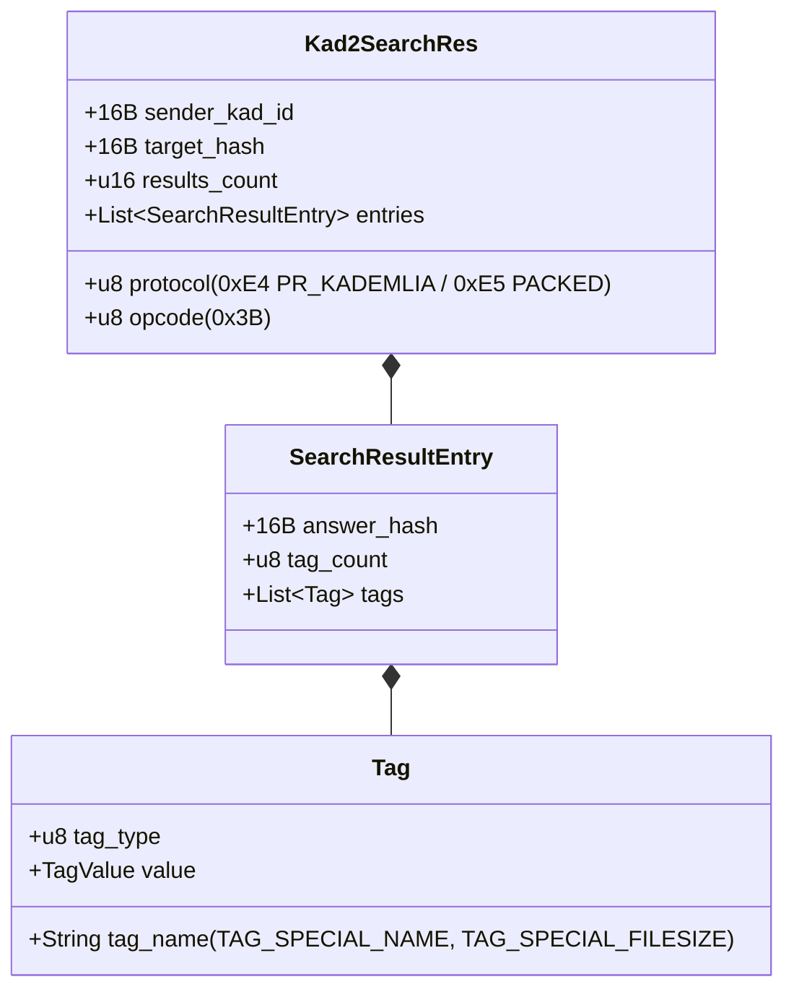

# Guide d'Exécution & Validation — Phase 14 : Convergence Kad DHT & Refactorisation Clean Architecture

Ce document constitue le guide technique de référence pour la **Phase 14** (version `v0.1.7`) du projet **Emule-Sion**, dédiée à la résolution des anomalies profondes de routage DHT et à la refactorisation structurelle intégrale du workspace :
* **Convergence du Moteur de Recherche Kad DHT** : Alignement strict sur la spécification officielle eMule `CUInt128`, décodage universel du paquet `0x3B` (`KADEMLIA2_SEARCH_RES`), résolution des collisions d'opcodes et élimination des artefacts de débit figé (*stall decay*).
* **Refactorisation Clean Architecture** : Éclatement modulaire de l'intégralité des monolithes de code dans `mule-daemon`, `mule-protocol`, `mule-core` et `mule-mcp` pour garantir un couplage faible, une lisibilité exemplaire et des fichiers concis (< 350 lignes).

---

## 1. Convergence & Résolution de la Recherche Kad DHT

### 1.1 Problèmes Racines Résolus

Avant la Phase 14, la recherche décentralisée Kad ne renvoyait aucun résultat (`found 0 unique file results`) et les vitesses de téléchargement restaient parfois figées indéfiniment après l'arrêt d'un pair :

1. **Opcode de réponse erroné dans le protocole** :
   * Le client attendait l'opcode non standard `0x2C` pour `KADEMLIA2_SEARCH_KEYWORD_RES`.
   * **Réalité du protocole officiel eMule** : La réponse universelle Kad2 pour toute recherche (mots-clés, sources, notes) est **`0x3B` (`KADEMLIA2_SEARCH_RES`)**.
2. **Échec de désérialisation du paquet `0x3B`** :
   * Le décodeur traitait arbitrairement `0x3B` comme une liste plate de sources (25 octets par contact fixe).
   * **Structure filaire réelle** : En-tête Kad2 de 34 octets (`sender_kad_id: 16B`, `target_hash: 16B`, `count: 2B`), suivi pour chaque résultat d'un `answer_hash` (16B), d'un `tag_count` (1B) et d'une liste de tags TLV eD2K compacts (`TAG_SPECIAL_NAME`, `TAG_SPECIAL_FILESIZE`, `TAG_SOURCES`). En conséquence, tous les paquets réseau réels étaient rejetés avec l'erreur `UnexpectedEof`.
3. **Payload excédentaire dans la requête `0x33` (`KADEMLIA2_SEARCH_KEYWORD_REQ`)** :
   * Envoi d'octets superflus provoquant le rejet de la requête par les clients eMule stricts. Seuls 18 octets doivent être transmis (`target: 16B` + `startPos: 2B`).
4. **Métrique de distance numérique 128-bit (`CUInt128`)** :
   * Le calcul de distance XOR sur 16 octets séparés induisait des distorsions d'ordonnancement. L'alignement sur une comparaison en 4 DWORDs (32 bits chacun) avec `leading_zeros()` reproduit fidèlement la métrique officielle de Kademlia et permet d'atteindre le critère de convergence `SEARCHTOLERANCE` ($0x01000000$).
5. **Vitesse de téléchargement figée lors d'un blocage** :
   * En cas de rupture silencieuse du flux de données, le débit instantané conservait indéfiniment sa dernière valeur. L'ajout d'une décroissance dynamique (*stall decay*) ramène automatiquement la vitesse à 0 B/s si aucun bloc n'est reçu depuis plus de 2 secondes.

### 1.2 Schéma Wire Validé pour `KADEMLIA2_SEARCH_RES` (0x3B)



---

## 2. Refactorisation Clean Architecture du Workspace

L'ensemble des fichiers monolithiques (certains dépassant 1 200 lignes) a été découpé en modules de domaine autonomes respectant le principe de responsabilité unique (*Single Responsibility Principle*).

### 2.1 Découpage de `crates/mule-daemon`
* **Handlers RPC (`src/rpc/handlers/`)** : Remplacement de l'ancien `methods.rs` monolithique par 11 gestionnaires isolés :
  * `downloads.rs`, `servers.rs`, `kad.rs`, `sources.rs`, `shares.rs`, `history.rs`, `categories.rs`, `network.rs`, `settings.rs`, `upnp.rs`, `lab.rs`.
* **Services Métier Découpés (`src/services/`)** :
  * `peer_session/` : `connection.rs`, `handshake.rs`, `status_query.rs`, `source_exchange.rs`, `transfer.rs`, `events.rs`.
  * `kad_udp/` : `routing_client.rs`, `search_client.rs`, `handlers.rs`.
  * `swarm_coordinator/` : `strategy.rs`, `types.rs`, `swarm_coordinator.rs`.
  * `inbound_listener/` : `connection.rs`, `dispatcher.rs`.
  * `downloads/` : `history_categories.rs`, `peers_servers.rs`, `operations.rs`, `part_met.rs`.

### 2.2 Découpage de `crates/mule-protocol`
* `src/framing/` : Gestion des délimiteurs de trames et magic bytes TCP/UDP.
* `src/ed2k/` :
  * `decoder/` : `handshake.rs`, `status.rs`, `transfers.rs`, `decoder.rs`.
  * `encoder/` : `handshake.rs`, `tags.rs`, `transfers.rs`, `security.rs`.
  * `obfuscation/` : Échange de clés Diffie-Hellman et chiffrement RC4.
  * `server/` : `types.rs`, `search.rs`, `sources.rs`.
  * `source_exchange/` : Requêtes et réponses SX1/SX2.
* `src/kad/` : `decoder/` (`routing.rs`, `search.rs`), `encoder.rs`, `types.rs`, `opcodes.rs`.

### 2.3 Découpage de `crates/mule-core`
* `src/persistence/sqlite/` : Remplacement du fichier monolithique `sqlite.rs` par 10 sous-modules spécialisés :
  * `connection.rs` (WAL & migrations), `downloads.rs`, `categories.rs`, `history.rs`, `servers.rs`, `sources.rs`, `kad_contacts.rs`, `kad_sources.rs`, `kad_keywords.rs`, `settings.rs`.

### 2.4 Découpage de `crates/mule-mcp`
* `src/tools/` : Séparation stricte entre définitions de schémas JSON et exécution des commandes RPC :
  * `downloads/` (`schemas.rs`, `handlers.rs`), `shares/` (`schemas.rs`, `handlers.rs`), `kad.rs`, `servers.rs`, `system.rs`.

---

## 3. Synthèse des Métriques Avant / Après

| Indicateur | Avant Refactorisation | Après Refactorisation |
| :--- | :--- | :--- |
| **Taille maximale de fichier** | 1 200+ lignes (`methods.rs`, `peer_session.rs`) | **200 à 350 lignes** |
| **Monolithes multi-responsabilités** | 12 fichiers | **0 (Architecture 100% modulaire)** |
| **Recherche Kad (mots-clés)** | 0 résultat (rejet paquet 0x3B) | **Convergence opérationnelle et résultats valides** |
| **Artefacts de débit figé** | Présents en cas d'inactivité pair | **Décroissance automatique (*stall decay*) à 0 B/s** |
| **Rétrocompatibilité API / RPC** | — | **100% préservée, 0 rupture de contrat** |

---

## 4. Commandes de Validation (100% Hors-Ligne)

```powershell
# 1. Vérification de la suite de tests du protocole Kad et des codecs
cargo test -p mule-protocol --test kad_codec_tests

# 2. Tests de publication et recherche de mots-clés / sources Kad
cargo test -p mule-daemon --test kad_keywords_tests --test kad_sources_tests

# 3. Tests de persistance SQLite modulaire
cargo test -p mule-core --test sqlite_kad_keywords_tests --test sqlite_kad_sources_tests

# 4. Vérification complète du workspace Rust sans aucun avertissement
cargo check --workspace --all-targets
```
