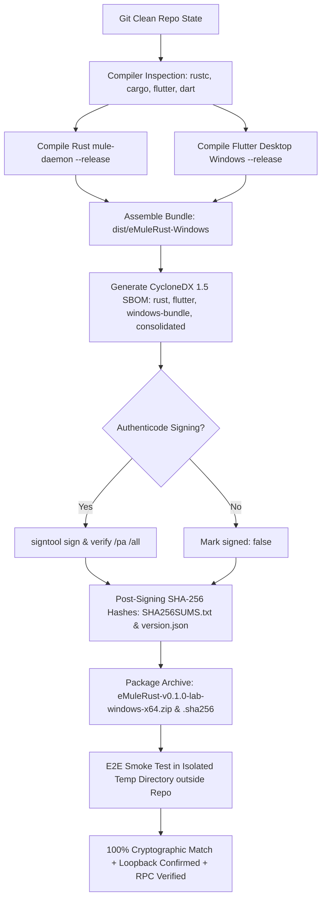

# Guide d'Exécution, de Validation et de Dépannage — Phase 3C : Durcissement Produit

Ce document constitue le guide technique de référence pour la **Phase 3C** du projet **eMule-Rust** (Durcissement produit & préparation à la production locale). Il détaille l'architecture de supervision, la gestion des sessions locales, les verrous d'exclusivité, la chaîne de packaging Windows sécurisée, les suites de tests et le guide complet de dépannage.

L'ensemble des procédures et démonstrations présentées ici est **100 % déterministe, reproductible et exécutable hors-ligne**, sans solliciter de serveurs eD2K ou nœuds Kad publics.

---

## 1. Architecture & Nouveautés de la Phase 3C

La Phase 3C consolide l'intégration entre le démon Rust (`mule-daemon`) et l'interface utilisateur Flutter Desktop (`apps/desktop`), assurant un cycle de vie robuste et sécurisé :

```
┌────────────────────────────────────────────────────────┐
│                   apps/desktop (Flutter)              │
│  ┌──────────────────────────────────────────────────┐  │
│  │                 DaemonSupervisor                 │  │
│  │  - Découverte via session.json + auth.token      │  │
│  │  - Auto-démarrage mule-daemon.exe si absent     │  │
│  │  - Résolution de course (2 UI simultanées)       │  │
│  │  - Reconnexion automatique (backoff exp)        │  │
│  │  - Détection d'incompatibilité protocolaire      │  │
│  └───────────▲───────────────────────────┬──────────┘  │
│              │ session.json              │ WS JSON-RPC │
└──────────────┼───────────────────────────┼─────────────┘
               │                           │
┌──────────────┼───────────────────────────▼─────────────┐
│  %APPDATA%/eMuleRust (Répertoire de travail local)     │
│  ├── mule.lock          (Verrou exclusif fs4)          │
│  ├── session.json       (Métadonnées d'instance publiques)│
│  ├── auth.token         (Token secret isolé, ACL local)│
│  ├── mule.db / -wal     (Persistance SQLite WAL)       │
│  └── part/              (Fichiers temporaires .part)   │
└──────────────▲─────────────────────────────────────────┘
               │
┌──────────────┴─────────────────────────────────────────┐
│               crates/mule-daemon (Rust)                │
│  - Verrou exclusif de dossier de travail (mule.lock)   │
│  - Repli dynamique sur port éphémère si 4660 occupé    │
│  - Écriture atomique (session.json.tmp -> sync -> ren) │
│  - Rejet des liens symboliques sur auth.token          │
│  - Nettoyage ordonné des sessions à l'arrêt (Ctrl+C)  │
└────────────────────────────────────────────────────────┘
```

### Garanties techniques validées
1. **Verrou exclusif d'instance (`crates/mule-daemon/src/lock.rs`)** :
   - Protégé par l'API `fs4::FileExt::try_lock()` sur `mule.lock`.
   - Empêche strictement deux démons d'ouvrir simultanément la même base SQLite ou les mêmes fichiers `.part`.
   - Si une seconde instance tente de démarrer, elle s'arrête immédiatement avec l'erreur `DaemonError::AlreadyRunning`.

2. **Découverte de session atomique et durabilité Windows (`crates/mule-daemon/src/session.rs`)** :
   - `session.json` contient : `protocolVersion`, `instanceId`, `pid`, `endpoint`, `startedAtUnixMs`.
   - Écriture atomique avec `sync_all()` et boucle de réessais (retries avec backoff de 20ms) lors du remplacement sous Windows pour éliminer tout conflit avec des verrous de partage temporaires (indexeur de fichiers, antivirus, lecteur concurrent).
   - Côté Flutter, lecture tolérante aux écritures en cours : un fichier vide ou en cours de remplacement `.tmp` déclenche des réessais courts au lieu d'interpréter hâtivement l'absence du démon.
   - Suppression propre de `session.json` lors de l'arrêt gracieux du démon.

3. **Sécurité et isolation stricte de `auth.token`** :
   - **Non-exposition** : Le secret d'authentification n'est **jamais** placé dans `session.json` ni affiché dans les flux `stdout` du démon (`(redacted)`).
   - **Protection contre les liens** : Rejet formel des liens symboliques ou reparse points Windows (`symlink_metadata`).
   - **Jeton à haute entropie CSPRNG** : Généré directement à partir de 32 octets aléatoires issus du générateur cryptographique du système d'exploitation (`rand::rngs::OsRng` via `try_fill_bytes`, dépendant de `rand 0.9` verrouillé dans `Cargo.lock`), encodé sous la forme stricte de 64 caractères hexadécimaux (`AUTH_TOKEN_HEX_LEN = 64`). Tout token non conforme (taille != 64 ou caractères non hexadécimaux) est immédiatement rejeté par Rust et Flutter.
   - **Zéro fuite côté client** : Le client Flutter et son superviseur ne journalisent jamais le token dans les messages d'erreur ou traces d'exceptions.

4. **Superviseur Flutter résilient (`apps/desktop/lib/services/daemon_supervisor.dart`)** :
   - **Priorité aux binaires packagés** : Recherche de `mule-daemon.exe` aux côtés de l'exécutable Flutter (`Platform.resolvedExecutable`), dans `bin/`, puis dans les cibles de développement.
   - **Résolution de la course au démarrage** : Si deux clients Flutter sont lancés simultanément sur un dossier vierge, l'un lance le démon ; le second processus démon sort avec `AlreadyRunning`, et la seconde UI Flutter détecte l'apparition du `session.json` créé par le premier et s'y connecte de manière transparente.
   - **Récupération des sessions obsolètes avec garde anti-course atomique** : Si `session.json` pointe vers un démon inaccessible (port fermé), Flutter effectue une relecture de confirmation et compare le contenu avant toute suppression pour éviter d'écraser une session valide concurrente, puis démarre une nouvelle instance.
   - **Reconnexion avec backoff exponentiel** : En cas de coupure socket inopinée, le superviseur tente de se reconnecter (500ms, 1s, 2s, 4s... plafonné à 10s).
   - **Détection des versions incompatibles** : Affichage d'une bannière bloquante (`IncompatibleVersionBanner`) si `protocolVersion` diffère de la version 1 supportée.
   - **Politique de cycle de vie et supervision** : Si l'UI Flutter a elle-même instancié le démon enfant, elle l'arrête proprement lors de sa fermeture (`stop()`). À l'inverse, si elle s'est connectée à un démon autonome existant (service local ou lancé via la CLI), ce dernier continue de vivre indépendamment après la fermeture de l'UI.

5. **Pipeline de build et packaging sécurisé (`scripts/build_windows_release.ps1`)** :
   - Conforme à la politique d'exécution PowerShell sans recours à `-ExecutionPolicy Bypass`.
   - Assemble le bundle autonome dans `dist/eMuleRust-Windows/` avec le manifeste de traçabilité `version.json`.

---

## 2. Prérequis & Environnement

| Composant | Version minimale recommandée | Remarque |
| :--- | :--- | :--- |
| **Système d'exploitation** | Windows 10/11 (x64) | Support des sockets TCP locaux, verrous `fs4` et desktop Flutter |
| **Rust & Cargo** | 1.80.0+ (stable) | Rust 1.98.1 validé avec `clippy` et `rustfmt` |
| **Flutter SDK** | 3.24.0+ (stable) | Flutter 3.47.2 validé avec support bureau activé (`flutter config --enable-windows-desktop`) |
| **Visual Studio C++** | Build Tools 2022 | Composants desktop C++ requis par Flutter Windows |

Vérifier les prérequis en ligne de commande :
```powershell
rustc --version
cargo --version
flutter --version
flutter doctor
```

---

## 3. Commandes de Vérification Qualité (100% Offline)

Toutes les commandes ci-dessous doivent s'exécuter avec succès :

### 3.1 Workspace Rust (Format, Clippy, Tests)
```powershell
# 1. Vérification du formatage du code
& "$env:USERPROFILE\.cargo\bin\cargo.exe" fmt --check

# 2. Analyse statique stricte (zéro warning toléré)
& "$env:USERPROFILE\.cargo\bin\cargo.exe" clippy --workspace --all-targets --all-features -- -D warnings
& "$env:USERPROFILE\.cargo\bin\cargo.exe" clippy --workspace --all-targets -- -D warnings

# 3. Exécution complète des 87 tests d'intégration, unitaires et proptests Rust (avec support lab)
& "$env:USERPROFILE\.cargo\bin\cargo.exe" test --workspace --all-features
```

*Résultats validés :*
- `mule-format` : 19 tests passés (AICH, eD2K hashing, liens parsing/normalisation, .met parsing & offsets).
- `mule-core` : 12 tests passés (RangeSet, insertion, fusion, PartFile persistance, restauration SQLite `get_all_downloads`, invariants proptest de permutation et résistance à la corruption SQLite sans écrasement).
- `mule-daemon` : 10 tests passés (Verrouillage exclusif, session atomique avec retries & sync_all, validation token, port de repli éphémère, contrat JSON-RPC, transfert inter-démons avec crash à 50% et reprise intègre, isolation multi-téléchargements sans diaphonie, tolérance aux sources lentes).
- `mule-protocol` : 46 tests passés (Framing eD2K zéro unsafe, fragmentation octet par octet, limites strictes, paquets malformés, machine à états de lab, tracker in-flight, indexation des hashes hébergés, transfert TCP loopback, 10 tests adverses et 2 suites proptest d'invariants de capacité).

### 3.2 Client Flutter Desktop (Analyse & Tests)
```powershell
cd d:\Projet\eMule-Rust\apps\desktop

# 1. Analyse statique Flutter
& "C:\Users\Lou\flutter\bin\flutter.bat" analyze

# 2. Exécution des 31 tests Flutter
& "C:\Users\Lou\flutter\bin\flutter.bat" test
```

*Résultats validés :*
- `No issues found!`
- `All tests passed! (31/31 passed)` comprenant :
  - Tests unitaires de modèles, DTOs et formatters.
  - Tests de contrats WebSocket JSON-RPC et streaming d'événements.
  - Tests de widgets, virtualisation de liste (500 items sans lag), filtrage et dialogue d'ajout de liens.
  - Tests du superviseur : auto-start, réutilisation de session, gestion de course simultanée, session tronquée, session obsolète, refus de version incompatible et gestion d'erreur de token sans fuite de secret.
  - Test E2E complet contre le vrai binaire `mule-daemon.exe`.

---

## 4. Modes de Lancement en Développement

### Option A : Mode Automatique / Production Locale (Recommandé)
Dans ce mode, Flutter supervise directement le démon :
```powershell
cd d:\Projet\eMule-Rust\apps\desktop
flutter run -d windows
```
- Flutter découvre `%APPDATA%\eMuleRust\session.json`.
- Si aucune instance n'est trouvée, il démarre automatiquement `mule-daemon.exe` en arrière-plan.
- La connexion WebSocket JSON-RPC 2.0 s'établit et la pastille de statut passe au vert (`Connecté`).

### Option B : Démon Rust Autonome + Flutter Développeur
Idéal pour observer les logs bruts du démon en temps réel :

**Terminal 1 (Démon Rust) :**
```powershell
cd d:\Projet\eMule-Rust
cargo run -p mule-daemon -- --workdir "$env:APPDATA\eMuleRust"
```
*Le démon affiche son PID, l'acquisition du verrou `mule.lock`, son port d'écoute et la création de `session.json`.*

**Terminal 2 (Application Flutter) :**
```powershell
cd d:\Projet\eMule-Rust\apps\desktop
flutter run -d windows
```
*Flutter détecte la session existante et s'y connecte immédiatement.*

### Option C : Mode Maquette Isolée (Fake Client)
Pour itérer rapidement sur l'interface graphique sans démon backend :
```powershell
cd d:\Projet\eMule-Rust\apps\desktop
flutter run -d windows --dart-define=USE_FAKE_DAEMON=true
```

---

## 5. Flux de Démonstration Pas-à-Pas (100% Hors-Ligne)

### Étape 1 : Vérification de l'interface et du statut de connexion
1. Lancer l'application (Mode A ou B).
2. Dans la barre latérale gauche, observer l'indicateur de statut : **Point vert « Connecté »**.
3. Le sous-titre affiche uniquement le point de terminaison public local (ex. `127.0.0.1:4660` ou port éphémère attribué) et la version du protocole `v1`. Aucun chemin de fichier sensible ni jeton secret n'est affiché.

### Étape 2 : Ajout d'un lien eD2K local (Données de test simulées)
1. Cliquer sur le bouton **« + Ajouter un lien eD2K »** dans la barre supérieure.
2. Coller un lien eD2K de test syntaxiquement valide :
   `ed2k://|file|TestVideo_Offline_Demo.mkv|25000000|0123456789abcdef0123456789abcdef|/`
   > [!NOTE]
   > Cet exemple constitue une **URI syntaxiquement valide avec des données simulées**. La taille (23.84 MB) et le hash MD4 démontrent la validation locale de l'intégrité et du formatage sans présumer de la présence d'un pair réel sur un réseau distant.
3. Observer la validation dynamique : le nom, la taille et le hash MD4 s'affichent instantanément en vert.
4. Cliquer sur **« Ajouter le téléchargement »**.
5. Le téléchargement apparaît dans la liste avec le statut initial exact de l'enum RPC/UI : **`Queued`** (En attente).

### Étape 3 : Injection de données simulées
1. Cliquer sur le bouton **« Outils de simulation »** dans l'en-tête.
2. Sélectionner le téléchargement dans la liste.
3. Cliquer sur **« Injecter 10 % »** ou **« Injecter bloc de part »** :
   - La barre de progression avance en temps réel.
   - Le statut passe à `Downloading`.
   - Le débit de transfert et le temps restant (ETA) sont calculés de manière réactive.

### Étape 4 : Contrôle de flux (Pause / Reprise / Suppression)
1. Cliquer sur le bouton **Pause** : le statut passe à `Paused`, le débit tombe à 0 Ko/s.
2. Cliquer sur le bouton **Reprendre** : le statut repasse à `Downloading` et reprend à partir des octets persistés.
3. Cliquer sur **Supprimer** : confirmation modale, puis nettoyage immédiat des fichiers `.part` et des métadonnées SQLite.

### Étape 5 : Tests de Résilience et Crashs Indépendants

Pour valider l'indépendance et la robustesse des composants, trois scénarios de crash doivent être vérifiés séparément :

#### Cas A : UI tuée ou Démon autonome, Démon persistant
1. Lancer le démon en arrière-plan (Option B ou démon déjà actif) ou lancer l'application Flutter et injecter des données de test.
2. Fermer brutalement l'interface Flutter (`Alt+F4` ou via le Gestionnaire des tâches sans déclencher `stop()`), ou fermer une UI connectée à un démon autonome préexistant.
3. Constater que `mule-daemon.exe` continue de s'exécuter en arrière-plan et conserve son verrou exclusif `mule.lock`.
4. Relancer l'application Flutter : elle découvre immédiatement `session.json`, vérifie la validité du port et du token 64-hex, s'y rattache sans relancer de second démon et affiche l'état intact.
*(Note : lorsque l'UI est fermée normalement alors qu'elle supervisait elle-même le démon enfant, elle termine son processus enfant pour éviter les processus orphelins).*

#### Cas B : Démon tué, UI vivante
1. Alors que l'application Flutter est ouverte et connectée, tuer le processus démon en console :
   ```powershell
   Get-Process mule-daemon -ErrorAction SilentlyContinue | Stop-Process -Force
   ```
2. Observer l'interface Flutter :
   - La pastille passe instantanément à l'état `Reconnecting...`.
   - Le superviseur applique le backoff exponentiel sans saturer le processeur.
3. Dès que le démon est redémarré (ou auto-relancé par le superviseur) :
   - La connexion est rétablie automatiquement.
   - Le client détecte le nouvel `instanceId`, réinitialise son compteur de séquence et demande un snapshot complet (`downloads.list`), actualisant l'écran sans intervention manuelle.

#### Cas C : Crash total / Arrêt à froid
1. Tuer simultanément Flutter et le démon (`Ctrl+C` ou fermeture de session).
2. Relancer l'application Flutter :
   - Le démon démarre, ouvre `mule.db` (SQLite WAL), restaure les intervalles dans `RangeSet`, et l'UI affiche fidèlement l'avancement persisté.

### Étape 6 : Course au démarrage de deux UI simultanées
1. Sur un répertoire de travail vierge sans démon actif, lancer simultanément deux fenêtres Flutter.
2. Constater qu'un seul `mule-daemon.exe` démarre et acquiert le verrou `mule.lock`.
3. Le second superviseur attend que `session.json` soit écrit et s'y connecte sans conflit ni message d'erreur.

---

## 6. Guide de Dépannage (Troubleshooting)

### Problème 1 : Message « Une autre instance du démon est déjà active sur ce répertoire »
- **Cause** : Un démon précédent retient le verrou exclusif `mule.lock`.
- **Solution** :
   ```powershell
   Get-Process mule-daemon -ErrorAction SilentlyContinue | Stop-Process -Force
   ```
   Le verrou se libère dès l'arrêt du processus.

### Problème 2 : Conflit sur le port réseau par défaut (`127.0.0.1:4660`)
- **Comportement automatique** : Le démon bascule automatiquement sur un port éphémère (`127.0.0.1:0`) et publie l'adresse effective dans `session.json`. L'application Flutter lit dynamiquement ce point d'accès.

### Problème 3 : Erreur d'authentification (`Authentication Failed`)
- **Cause** : Désynchronisation de `auth.token`.
- **Solution** :
   1. Arrêter le démon.
   2. Supprimer les fichiers de session :
      ```powershell
      Remove-Item "$env:APPDATA\eMuleRust\session.json" -ErrorAction SilentlyContinue
      Remove-Item "$env:APPDATA\eMuleRust\auth.token" -ErrorAction SilentlyContinue
      ```
   3. Relancer l'application.

### Problème 4 : Bannière rouge « Version du démon incompatible »
- **Cause** : `protocolVersion` incompatible entre le client et le démon.
- **Solution** : Recompiler le démon pour synchroniser les versions :
   ```powershell
   cargo build --release -p mule-daemon
   ```

### Problème 5 : Réinitialisation complète pour repartir d'un environnement propre
> [!CAUTION]
> Cette commande supprime irréversiblement l'ensemble des téléchargements en cours, la base SQLite locale et les fichiers temporaires `.part`. À n'utiliser qu'à des fins de réinitialisation de tests de laboratoire.

```powershell
# Confirmer la fermeture des processus
Get-Process mule-daemon,desktop,eMuleRust -ErrorAction SilentlyContinue | Stop-Process -Force

# Supprimer le répertoire de travail
Remove-Item -Recurse -Force "$env:APPDATA\eMuleRust"
```

---

## 7. Packaging et Déploiement de Release Windows

Pour générer le livrable complet sans contourner la politique de sécurité PowerShell du système :

```powershell
cd d:\Projet\eMule-Rust
powershell -NoProfile -ExecutionPolicy RemoteSigned -File scripts\build_windows_release.ps1
```

> [!TIP]
> **Pourquoi `RemoteSigned` plutôt que `Bypass` ?**
> `RemoteSigned` autorise l'exécution des scripts créés localement sur votre machine tout en exigeant une signature numérique de confiance pour les scripts téléchargés depuis Internet. Pour une distribution grand public, le script et les exécutables peuvent être signés à l'aide d'un certificat de signature de code Authenticode (`Set-AuthenticodeSignature`).

### Contenu du bundle généré dans `dist\eMuleRust-Windows\` :
- `eMuleRust.exe` : Exécutable Flutter Desktop principal.
- `bin/mule-daemon.exe` : Démon Core autonome packagé aux côtés de l'UI.
- `flutter_windows.dll` et dépendances natives.
- `data/` : Assets, icônes et polices de l'application.
- `version.json` : Manifeste de traçabilité incluant le SHA Git, la date de compilation et la version du protocole JSON-RPC.

---

## 8. Phase 4.1 : Socle Protocolaire eD2K Réseau (`crates/mule-protocol`)

Le composant `mule-protocol` constitue la fondation réseau du transfert pair-à-pair eD2K, garantissant une étanchéité absolue vis-à-vis du stockage (`mule-core`) et une robustesse totale face aux flux malveillants ou fragmentés.

### 8.1 Garanties architecturales et sécurité
1. **Zéro `unsafe` (`#![forbid(unsafe_code)]`)** :
   Garantie au niveau de la compilation qu'aucun bloc mémoire non vérifié n'est manipulé.
2. **Découplage strict du Core** :
   Le protocole ignore l'existence de SQLite, des fichiers `.part` ou des structures internes (`RangeSet`). Toutes les interactions passent par des traits asynchrones purs (`DownloadSink` et `DownloadPlanner`).
3. **Plafonds stricts anti-déni de service (DoS)** :
   - `MAX_FRAME_BYTES = 1_048_576` (1 MiB) : rejet immédiat avant toute tentative d'allocation de buffers démesurés.
   - `MAX_BUFFERED_BYTES = 2_097_152` (2 MiB) : coupure préventive si un pair accumule des données partielles sans compléter de trame valide.
   - `MAX_STRING_BYTES = 16_384` (16 KiB) : protection contre les chaînes de tags surdimensionnées.
   - `MAX_TAGS_PER_MESSAGE = 256` : limitation du nombre de métadonnées par message.
   - `MAX_PEERS_PER_RESPONSE = 500` : limitation des réponses de sources de pairs.
4. **Codec de streaming `PacketCodec` & reconnaissance de protocoles** :
   - Décodage à coût zéro sur `bytes::BytesMut`.
   - Support natif des protocoles eD2K standard (`0xE3`), eMule étendu (`0xC5`), de laboratoire (`0xEE`), et framing reconnu pour le protocole compressé eMule (`0xD4`).
   - *Précision de sécurité sur 0xD4* : la décompression compatible et ses limites de sécurité post-décompression (ratio de décompression maximal plafonné contre les bombes de décompression, plafond par type de message et rejet strict de flux incomplets) seront intégrées dans une phase dédiée.
   - Trait d'abstraction `PacketLimits` prévoyant des plafonds contextuels par famille de messages.
   - Reconstitution déterministe lors d'une fragmentation extrême (validation octet par octet dans les tests).
   - Découpage ordonné de trames multiples contiguës au sein d'un même tampon réseau.
5. **Couverture de tests exhaustifs (33/33 validés dans `mule-protocol`)** :
   - `tests/packet_codec.rs` : Aller-retour standard, extraction multi-paquets, trames à charge utile vide, blocs eD2K de 180 KiB (`184_320` octets), fragmentation unitaire.
   - `tests/protocol_limits.rs` : Rejet des longueurs nulles, dépassement de `MAX_FRAME_BYTES`, attaques par `u32::MAX`, débordement d'accumulateur `BufferOverflow`, respect des limites personnalisées.
   - `tests/malformed_packets.rs` : Rejet des octets de protocole inconnus (`0x00`, `0x42`, `0xFF`), gestion des en-têtes tronqués sans panique (`Ok(None)`), intégration asynchrone des traits `DownloadSink` et `DownloadPlanner`.
   - `tests/lab_state_machine.rs` : Handshake nominal client/serveur, rejet de version incompatible, rejet de nonce mismatch, rejet du double Hello, interdiction formelle des transferts avant l'état Ready, fermeture propre par Goodbye, sérialisation déterministe de tous les messages `LabMessage`.
   - `tests/lab_in_flight_and_blocks.rs` : Plafond strict des 8 requêtes en vol (`MAX_IN_FLIGHT_REQUESTS`), rejet des doublons, rejet des blocs non sollicités, rejet des discordances de longueur, service sécurisé en mémoire par `LabSourceEngine`.
   - `tests/loopback_transfer.rs` : Transfert TCP loopback complet (53 blocs d'une part eD2K de 9.5 MB) avec livraison intentionnellement dans le désordre, fragmentation TCP unitaire du handshake, détection de corruption de bloc empêchant la finalisation, et reprise après déconnexion inopinée.

---

## 9. Phase 4.2 : Machine à États P2P et Transfert Loopback Inter-Démons

La Phase 4.2 met en place un protocole de banc d'essai local, isolé et déterministe, garantissant qu'aucun socket ne dialogue avec le réseau eD2K public tant que l'intégrité et la résilience locale ne sont pas irréprochables.

### 9.1 Distinction Fondamentale
```
lab / loopback wire protocol (PR_LAB = 0xEE) ≠ eD2K / eMule historical wire protocol
```
- Le protocole de laboratoire opère sous le magic byte `PR_LAB = 0xEE`.
- Il utilise des messages typés explicites (`Hello`, `HelloAck`, `FileOffer`, `RequestBlock`, `BlockData`, `BlockRejected`, `Goodbye`, `ProtocolError`).
- Aucun chemin de fichier local (`PathBuf`) n'est jamais accepté depuis le réseau : le moteur de test [`LabSourceEngine`](crates/mule-protocol/src/lab/source_engine.rs) sert ses fixtures depuis un catalogue en mémoire indexé uniquement par hash 16 octets.

### 9.2 Machine à États Pure (`PeerStateMachine`)
- États mutuellement exclusifs : `Disconnected`, `Connecting`, `AwaitingHello`, `AwaitingHelloAck { local_nonce }`, `Ready { remote_peer_id, negotiated_version }`, `Closing`, `Closed`, `Failed { reason }`.
- Toute violation protocolaire ou erreur réseau entraîne une transition immédiate et irréversible vers `Failed`. Un état `Failed` ne redevient jamais `Ready`.
- Interdiction stricte de recevoir ou émettre `RequestBlock` ou `BlockData` avant d'avoir atteint l'état `Ready`.

### 9.3 Pipeline de Transfert et Intégration Core
1. **Contrôle de congestion et requêtes en vol** :
   Le composant [`InFlightTracker`](crates/mule-protocol/src/lab/in_flight.rs) borne les requêtes simultanées à `MAX_IN_FLIGHT_REQUESTS = 8`. Tout bloc reçu sans demande préalable est rejeté avec fermeture immédiate de la session.
2. **Tolérance prouvée à la livraison désordonnée** :
   Dans le test `test_nominal_loopback_transfer_with_shuffled_blocks`, les 53 blocs composant la part de 9 728 000 octets sont demandés et écrits dans le désordre. Le `RangeSet` de `mule-core` fusionne dynamiquement les intervalles au fur et à mesure de l'écriture sur le fichier `.part`.
3. **Validation cryptographique finale** :
   À l'issue des 53 blocs, le calcul du hash eD2K sur le fichier `.part` physique confirme une identité parfaite avec `FIXTURE_EXACT_ONE_PART` (`d815a0409aaa0b4279dd86e580bb043f`).
4. **Détection de corruption et reprise sur coupure** :
   - L'altération d'un octet n'est pas détectable instantanément lors de l'écriture sans preuve AICH par bloc ; elle est détectée lors de la vérification cryptographique de la part complète (calcul du hash racine eD2K de 9 728 000 octets) : aucune finalisation n'est permise en cas de discordance.
   - En cas d'interruption réseau après réception partielle (ex. 180 Ko reçus), la reconnexion interroge `RangeSet::missing_within` et ne redemande strictement que les octets manquants, permettant une reprise à chaud intègre.

---

## 10. Phase 4.3 : Transfert Loopback Inter-Démons Intégré, Feature Lab et Tolérance aux Pannes

La Phase 4.3 achève l'intégration de bout en bout du pipeline de transfert en exécutant un transfert complet entre deux processus `mule-daemon` distincts, tout en isolant le code de test derrière une feature Cargo dédiée et en prouvant la résilience du stockage en cas de crash brutal.

### 10.1 Feature Cargo `lab-loopback` & Sécurité des Livrables de Production
- **Isolation stricte** : Les fixtures synthétiques (`FIXTURE_EXACT_ONE_PART`), le moteur de source en mémoire et les routes RPC de test (`lab.addPeerSource`) sont strictement isolés derrière la feature Cargo `lab-loopback` dans `crates/mule-protocol` et `crates/mule-daemon`.
- **Livrables de production allégés et durcis** : Les builds standards (`cargo build --release`) conservent `default = []`. Ils ne compilent ni n'embarquent le moindre code de mock ou de serveur de test, garantissant une surface d'attaque minimale et aucun résidu de banc d'essai.

### 10.2 Architecture du Transfert Inter-Démons (`crates/mule-daemon`)
```
┌────────────────────────────────────────────────────────┐
│                   Démon A (Source Lab)                │
│  - Socket TCP loopback éphémère (127.0.0.1:0)          │
│  - Framing binaire PR_LAB (0xEE)                       │
│  - Sert FIXTURE_EXACT_ONE_PART (9 728 000 octets)      │
│  - Catalogue mémoire indexé par hash 16 octets         │
└───────────────────────────▲────────────────────────────┘
                            │ TCP Loopback (0xEE)
┌───────────────────────────▼────────────────────────────┐
│                  Démon B (Client Démon)                │
│  - Répertoire isolé (mule.lock, SQLite WAL, .part)     │
│  - JSON-RPC WebSocket sur port local éphémère          │
│  - Pipeline run_lab_download :                         │
│    • InFlightTracker (max 8 requêtes en vol)           │
│    • RangeSet::missing_within (requêtes ciblées)       │
│    • Écriture atomique dans .part et sync SQLite WAL   │
│    • Vérification racine eD2K puis finalisation .txt   │
└────────────────────────────────────────────────────────┘
```

1. **Cycle d'états streaming vérifié via WebSocket JSON-RPC** :
   - `Queued` : Le lien eD2K est soumis via `downloads.addEd2kLink`.
   - `WaitingForSources` : Le téléchargement attend qu'une source active soit identifiée.
   - `Downloading` : Connexion établie avec la source loopback, négociation de la machine à états (`Hello` / `HelloAck`), et streaming des blocs de 180 KiB.
   - `Verifying` : Dès la réception du dernier bloc couvrant les 9 728 000 octets, l'état bascule immédiatement sur `Verifying` pour empêcher toute utilisation prématurée avant le contrôle d'intégrité.
   - `Completed` : Le hash eD2K racine calculé sur le fichier physique `.part` correspond au hash de référence (`d815a0409aaa0b4279dd86e580bb043f`). Le fichier `.part` est renommé atomiquement vers le fichier de destination finale (`.txt`).

### 10.3 Test d'Interruption Brutale à ~50% et Reprise Intègre (`tests/inter_daemon_transfer.rs`)
Le test d'intégration `test_inter_daemon_loopback_transfer_and_interruption_resumption` valide de bout en bout la résistance aux pannes :
1. **Transfert initial jusqu'à mi-parcours** : Le Démon B télécharge les blocs séquentiellement jusqu'à dépasser ~4.5 Mo (sur 9.72 Mo).
2. **Crash brutal simulé** : Interruption immédiate du serveur Axum et annulation de toutes les tâches asynchrones d'arrière-plan via `AppState::abort_all_tasks()`.
3. **Persistance WAL vérifiée** : Inspection de la base SQLite et du fichier `.part` : les plages acquises (environ 4.5 Mo à 5.0 Mo) sont intactes et persistées sur disque.
4. **Redémarrage à froid (Cold Restart)** : Une nouvelle instance du Démon B redémarre sur le **même répertoire de travail**. Le `DownloadService` interroge `Database::get_all_downloads()` et restaure instantanément en mémoire l'état du téléchargement et ses plages acquises.
5. **Reprise sans re-téléchargement** : Le client WebSocket se reconnecte, réinjecte la source loopback. Le planificateur `missing_within` constate les plages déjà présentes et **ne redemande strictement aucun octet déjà écrit**.
6. **Finalisation intègre** : Les blocs restants sont reçus, le digest eD2K est validé et le fichier finalisé est strictement identique à la référence.

### 10.4 Alignement de l'Interface Flutter Desktop (`apps/desktop`)
- Prise en charge de l'état `DownloadStatus.waitingForSources` dans l'énumération de domaine, le DTO RPC (`RpcDto.parseStatus`), et le thème visuel (`AppTheme.getStatusColor`).
- Tests unitaires et d'intégration Flutter Desktop : 31/31 passés, `flutter analyze` : zéro warning.

---

## 11. Phase 4.4 : Durcissement du Banc d'Essai (Cas Adverses, Invariants et Proptests)

La Phase 4.4 transforme chaque scénario d'échec critique en propriétés mathématiques et garanties formellement testées, avant toute phase d'archéologie eD2K.

### 11.1 Robustesse d'In-Flight et Gestion des Cas Adverses (`crates/mule-protocol`)
La suite `crates/mule-protocol/tests/lab_adversarial.rs` couvre exhaustivement les cas limites réseau :
1. **Neuvième requête en vol (`test_ninth_in_flight_request_rejected_without_leak`)** :
   Le régulateur `InFlightTracker` bloque toute tentative au-delà de 8 requêtes simultanées avec `InFlightError::CapacityReached { limit: 8 }`. Aucune écriture n'est déclenchée et la capacité reste rigoureusement plafonnée à 8 sans fuite.
2. **Réponse dupliquée (`test_duplicate_block_response_rejected`)** :
   La première livraison d'un bloc consomme l'entrée. Une seconde livraison du même bloc renvoie `InFlightError::UnsolicitedBlock` de manière idempotente sans double comptage ni sous-dépassement de capacité.
3. **Discordance de hash de fichier (`test_wrong_file_hash_response_rejected`)** :
   Toute réponse portant un hash distinct de la requête en vol est rejetée avec `UnsolicitedBlock`, et la requête initiale demeure protégée en attente.
4. **Discordance de taille de bloc (`test_length_mismatch_response_rejected`)** :
   Si un pair retourne une longueur différente de celle attendue (ex: 100 Ko au lieu de 180 Ko), le bloc est rejeté avec `InFlightError::LengthMismatch`.
5. **Expiration et livraison tardive (`test_reap_timeouts_and_late_block_rejection`)** :
   `reap_timeouts` extrait les requêtes expirées pour replanification immédiate. Un bloc arrivant en retard est rejeté comme non sollicité.
6. **Déconnexion abrupte avec 8 requêtes (`test_cancel_all_frees_capacity_on_disconnect`)** :
   `cancel_all` libère l'intégralité des 8 requêtes pour les remettre en file d'attente, restaurant instantanément la pleine capacité du tracker (`len == 0`, `can_request == true`).
7. **Rejet de bloc ciblé vs inconnu (`test_valid_block_rejected_frees_single_entry` / `test_unknown_block_rejected_fails`)** :
   Un `BlockRejected` légitime ne libère que la requête concernée en préservant les 7 autres. Un rejet portant sur un offset inconnu lève une erreur `UnsolicitedRejection`.
8. **Rejet strict des trames comprimées `0xD4` (`test_compressed_frame_0xd4_explicitly_rejected`)** :
   Toute trame `PR_EMULE_COMPRESSED` est rejetée au niveau du décodage (`LabMessage::from_raw_packet`) et de la machine à états (`PeerStateMachine::on_raw_packet`) avec `ProtocolViolation::CompressedProtocolUnsupported` tant que la décompression bornée n'est pas déployée.

### 11.2 Invariants et Tests de Propriété Formels (`proptest`)
1. **Invariance de permutation sur `RangeSet` (`crates/mule-core/tests/range_set_properties.rs`)** :
   Prouve que pour toute collection de plages d'octets disjointes insérées dans n'importe quel ordre aléatoire (shuffle), l'union canonique `ranges()`, la couverture `covered_len()`, et le calcul des trous `missing_within()` sont strictement identiques.
2. **Cohérence des états `InFlightTracker` (`crates/mule-protocol/tests/in_flight_properties.rs`)** :
   Vérifie que la capacité disponible est toujours exactement 8 - len, qu'aucun bloc ne peut être validé deux fois, et que `cancel_all` restaure toujours `len == 0`.

### 11.3 Isolation Multi-Téléchargements & Intégrité SQLite (`crates/mule-daemon`)
La suite `crates/mule-daemon/tests/daemon_adversarial.rs` valide l'étanchéité du démon :
1. **Multi-téléchargements concurrents sans diaphonie (`test_concurrent_downloads_no_crosstalk`)** :
   Deux fichiers distincts (368 Ko et 552 Ko) sont téléchargés simultanément depuis une source loopback partagée. Vérification sur disque : chaque fichier cible physique est créé, sa taille est exacte, son hash eD2K correspond fidèlement, et aucune interférence n'existe entre leurs fichiers `.part` ou métadonnées SQLite.
2. **Source à forte latence (`test_slow_source_delayed_delivery_recovers_cleanly`)** :
   Une source retardant ses réponses de 1 seconde est gérée passivement par le planificateur asynchrone sans emballement CPU ni boucle active.
3. **Résistance à la corruption de base SQLite (`test_corrupted_database_fails_explicitly_in_daemon`)** :
   Une base `mule.db` contenant des octets corrompus provoque un échec explicite au démarrage, **sans jamais supprimer ni écraser silencieusement** les données existantes sur disque.

---

## 12. Phase 5 : Archéologie eD2K Passive, Décodeurs Read-Only & Corpus de Fixtures

La **Phase 5** formalise la spécification documentaire du protocole historique eDonkey2000 / eMule, établit un corpus de fixtures binaires sous contrôle de version avec manifeste cryptographique, et déploie un sous-module de décodeurs en lecture seule (`mule-protocol::ed2k`) strictement découplé et passif.

### 12.1 Périmètre et Règles d'Étanchéité (100 % Hors-Ligne)
1. **Zéro socket réseau** : Le sous-module `mule-protocol::ed2k` ne crée aucun `TcpStream`, `UdpSocket`, `SocketAddr` ou tâche réseau asynchrone.
2. **Pas d'émission active** : Aucun encodeur n'est destiné à être émis vers des pairs réels dans cette phase. Seules des structures passives d'observation (`Ed2kHello`, `Ed2kHelloAnswer`, `Ed2kFileStatus`) sont produites.
3. **Découplage strict avec `lab`** : Les protocoles historiques (`0xE3`, `0xC5`, `0xD4`) sont entièrement séparés du protocole de laboratoire `PR_LAB` (`0xEE`), avec leurs propres plafonds de trames et aucun type de domaine partagé.
4. **Zéro `unwrap()`, zéro `expect()`** : Toutes les fonctions de décodage sont totalement sûres et vérifient chaque borne avant allocation.
5. **Rejet de `0xD4` (`PR_EMULE_COMPRESSED`)** : Rejet immédiat avec `Ed2kErrorKind::CompressedProtocolUnsupported` tant que la couche de décompression avec plafonds anti-bombe n'est pas mise en place.

### 12.2 Spécification Documentaire (`docs/ed2k/`)
L'ensemble de la documentation a été rédigé avec des références précises vers les codebases historiques (eMule v0.50a SourceForge, irwir/eMule, aMule) :
- `docs/ed2k/scope.md` : Délimitation formelle du mode passif et interdictions de connexion publique.
- `docs/ed2k/references.md` : Sources et fichiers de référence (`UpDownClient.cpp`, `ListenSocket.cpp`, `Packet.cpp`, `Tag.cpp`).
- `docs/ed2k/framing.md` : En-tête de trame (protocol 1 octet, longueur little-endian 4 octets, opcode 1 octet), endianness et comparaison de limites.
- `docs/ed2k/opcodes.md` : Catalogue exhaustif des opcodes pour les protocoles `0xE3`, `0xC5` et `0xD4`.
- `docs/ed2k/message-catalog.md` : Fiches normalisées détaillant wire format, bornes, décodage, erreurs et références pour `OP_HELLO`, `OP_HELLOANSWER`, `OP_FILESTATUS`, `OP_SETREQFILEID`, `OP_REQUESTPARTS`, `OP_SENDINGPART`.
- `docs/ed2k/limits.md` : Plafonds stricts par opcode (Hello ≤ 64 KiB, Data ≤ 256 KiB, tags ≤ 256, chaînes ≤ 1024 o).
- `docs/ed2k/compatibility-notes.md` : Variantes de tags spéciaux (1 octet vs nom), encodages de texte (ASCII / Windows-1252 / UTF-8), HighID vs LowID.
- `docs/ed2k/decisions/` :
  - `0001-ed2k-read-only.md` : Décodeurs stricts en lecture seule sans encodeur ni session.
  - `0002-no-public-network.md` : Interdiction absolue de connectivité réseau externe.
  - `0003-wire-lab-separation.md` : Découplage strict entre laboratoire et protocole historique.

### 12.3 Corpus de Fixtures & `manifest.json`
Les fixtures binaires sont hébergées dans `crates/mule-protocol/tests/fixtures/ed2k/` avec un manifeste `manifest.json` vérifiant leur SHA-256 et les comportements attendus :
- **Fixtures Valides** :
  - `hello_v1_minimal.bin` : Poignée de main standard minimale (0 tag).
  - `hello_v1_tags.bin` : Poignée de main complète avec tags typés (`name`, `version`, `prt`) et serveur.
  - `hello_answer.bin` : Réponse de poignée de main avec métadonnées de pair distant.
  - `file_status.bin` : Statut de fichier multi-parts avec masque binaire de disponibilité.
- **Fixtures Malformées (Entrées Hostiles)** :
  - `malformed/hello_truncated_header.bin` : En-tête tronqué (< 5 octets) $\rightarrow$ `UnexpectedEof` (context: "header", offset: 0).
  - `malformed/hello_truncated_tag.bin` : Tag déclarant 20 octets mais tronqué après 4 octets $\rightarrow$ `UnexpectedEof` (context: "tag_value_string", offset: 32).
  - `malformed/oversized_string.bin` : Chaîne de 1500 octets dépassant le plafond de 1024 $\rightarrow$ `OversizedString` (size: 1500, limit: 1024).
  - `malformed/too_many_tags.bin` : Compteur de 300 tags dépassant le plafond de 256 $\rightarrow$ `TooManyTags` (count: 300, limit: 256).
  - `malformed/unsupported_protocol_0xd4.bin` : Protocole compressé $0xD4$ $\rightarrow$ `CompressedProtocolUnsupported`.

### 12.4 Contrôles de Clôture & Garde d'Isolation Mécanique
Deux contrôles automatisés renforcent la garantie d'isolation :
1. **Garde d'isolation mécanique (`crates/mule-protocol/tests/ed2k_isolation_guard.rs`)** :
   - Scan statique automatisé de l'ensemble du sous-module `src/ed2k/` : interdiction formelle et vérifiée de tout import réseau (`std::net`, `tokio::net`, `TcpStream`, `UdpSocket`, `SocketAddr`, `axum`, `hyper`, etc.).
   - Absence totale de dépendance vers `mule-protocol::lab`.
   - Règle stricte « zéro `unwrap()`, zéro `expect()` » dans le code source de `ed2k/`.
   - Vérification que les routes RPC de laboratoire dans `mule-daemon` sont strictement conditionnées par `#[cfg(feature = "lab-loopback")]`.
2. **Validation dynamique complète du manifeste (`manifest.json`)** :
   - Schéma enrichi pour chaque fixture : `protocolByte`, `opcode`, `direction`, `origin`, `expected`, `expectedError`, `expectedOffset`.
   - Vérification dynamique du hash SHA-256 (via algorithme standard FIPS 180-4 sécurisé en pur Rust), des erreurs attendues et des offsets exacts de rejet dans le flux binaire.

### 12.5 Bilan des Tests Phase 5
- **Tests Rust** : **104 tests passés** (`cargo test --workspace --all-features`), incluant `ed2k_isolation_guard` et `ed2k_corpus_tests`.
- **Tests Flutter** : **31 tests passés** (`flutter test`).
- **Total général** : **135 tests validés à 100 %**.

---

## 13. Phase 6.1 : Encodeurs Déterministes eD2K Hors Réseau & Double Invariance Roundtrip

Le **Jalon 6.1** déploie la couche de sérialisation sur le fil déterministe et bornée pour les messages eD2K historiques (`mule-protocol::ed2k::encoder`), tout en maintenant la politique stricte **100 % hors-ligne**.

### 13.1 Architecture du Module `encoder` (`crates/mule-protocol/src/ed2k/encoder.rs`)
1. **Structure `Ed2kEncoder`** :
   - Encapsule `Ed2kLimits` pour contraindre chaque allocation mémoire.
   - Encodage des balises TLV reconnues (`Ed2kTag`) pour tous les types scalaires, hashes, chaînes et blobs.
   - Préservation sans altération des balises inconnues (`RawTag`).
   - Émission conforme des adresses serveur (`server_ip` 4 octets LE et `server_port` 2 octets LE).
2. **Erreurs typées contextuelles `Ed2kEncodeError`** :
   - Identifie précisément l'opcode en cours d'encodage, le champ fautif (`field`) et la nature de la violation (`Ed2kErrorKind`).
3. **Méthodes d'encodage sûres** :
   - `encode_hello(&self, &Ed2kHello) -> Result<RawPacket, Ed2kEncodeError>`
   - `encode_hello_answer(&self, &Ed2kHelloAnswer) -> Result<RawPacket, Ed2kEncodeError>`
   - `encode_file_status(&self, &Ed2kFileStatus) -> Result<RawPacket, Ed2kEncodeError>`
   - `encode_message(&self, &Ed2kMessage) -> Result<RawPacket, Ed2kEncodeError>`
   - `encode_to_bytes(&self, &Ed2kMessage) -> Result<Bytes, Ed2kEncodeError>`

### 13.2 Double Invariance Roundtrip (`crates/mule-protocol/tests/ed2k_roundtrip_tests.rs`)
La suite de 15 tests automatisés prouve formellement les deux propriétés d'invariance :

1. **Invariance de Fixture : `encode(decode(fixture)) == fixture`**
   - `hello_v1_minimal.bin` : 38 octets identiques au bit près.
   - `hello_v1_tags.bin` : Poignée de main complète reproduite à l'identique.
   - `hello_answer.bin` : Réponse avec métadonnées reproduite à l'identique.
   - `file_status.bin` : Statut multi-parts avec masque binaire reproduit à l'identique.

2. **Invariance Structurelle : `decode(encode(msg)) == msg`**
   - `test_synthetic_roundtrip_hello_all_tag_types` : Couverture exhaustive de toutes les variantes de `TagValue` (Hash, String, UInt32, Float32, Bool, Blob, UInt16, UInt8, UInt64) avec noms spéciaux et textuels.
   - `test_synthetic_roundtrip_hello_minimal_no_server_info` : Handshake minimal avec serveur nul.
   - `test_synthetic_roundtrip_hello_answer` : Réponse synthétique avec tags.
   - `test_synthetic_roundtrip_unknown_raw_tags_preservation` : Conservation parfaite des tags bruts (`RawTag`).
   - `test_synthetic_roundtrip_file_status_various_part_counts` : Vérification sur 0, 1, 7, 8, 9 et 53 parts.

3. **Rejets Numériques aux Limites** :
   - Dépassement du nombre maximal de tags (`TooManyTags`).
   - Dépassement de la longueur du nom de tag ou de la valeur de chaîne (`OversizedString`).
   - Dépassement de la taille de blob (`FrameTooLarge`).
   - Dépassement du plafond de trame pour l'opcode (`FrameTooLarge`).
   - Incohérence de longueur du masque binaire par rapport au nombre de parts (`MalformedField`).

### 13.3 Bilan Global des Tests (Phase 6.1)
- **Tests Rust** : **115 tests passés** (`cargo test --workspace --all-features`).
- **Tests Flutter** : **31 tests passés** (`flutter test`).
- **Total général du projet** : **146 tests validés à 100 %**.
- **Clippy** : 0 avertissement sur tout le workspace (`cargo clippy --workspace --all-targets --all-features -- -D warnings`).
- **Garde d'isolation** : Validée (0 socket, 0 import réseau, 0 dépendance lab, 0 unwrap/expect dans `src/ed2k/`).

---

## 14. Phase 6.2 : Sessions Historiques eD2K sur Loopback Fermé (`ed2k-loopback`)

Le **Jalon 6.2** établit les premières sessions réseau actives de poignée de main eD2K (`OP_HELLO` $\rightarrow$ `OP_HELLO_ANSWER` $\rightarrow$ `Ready`), strictement confinées à l'interface locale `127.0.0.1:0` derrière la feature opt-in `ed2k-loopback`.

### 14.1 Feature Cargo Dédiée & Confinement Hors Réseau
1. **Gating `ed2k-loopback`** :
   - `mule-protocol` et `mule-daemon` conditionnent l'accès à la session, aux types de pairs et au transport loopback via `feature = "ed2k-loopback"`.
   - Les builds de production par défaut (`default = []`) n'incluent ni listener eD2K, ni socket connector, ni pair de test.
2. **Confinement Loopback Stricte** :
   - Les sockets ne se lient qu'à `127.0.0.1:0`.
   - `Ed2kLoopbackClient` rejette formellement toute tentative de connexion vers une adresse non loopback (`addr.ip().is_loopback()`).
   - Zéro résolution DNS, zéro liste de serveurs, zéro bootstrap Kad, zéro découverte réseau.
   - Le pair de test sert un catalogue statique fermé en mémoire et ne reçoit aucun chemin de fichier, URL ou hôte arbitraire.
3. **Découplage UI / Daemon** :
   - L'interface Flutter Desktop ne connaît pas le protocole eD2K et continue d'interagir exclusivement via le protocole JSON-RPC local existant.

### 14.2 Architecture des Composants 6.2
1. **Machine à états pure `Ed2kSession` (`crates/mule-protocol/src/ed2k/session.rs`)** :
   - États : `Disconnected`, `Connecting`, `AwaitingHello`, `AwaitingHelloAnswer { local_handshake_id }`, `Ready { peer }`, `Closing`, `Closed`, `Failed { reason }`.
   - L'identité de handshake repose sur le `user_hash` (MD4 16 octets), `client_id`, port TCP et balises TLV (aucun concept de nonce non standard).
   - Validation stricte : rejet de double Hello (`DoubleHello`), rejet d'Answer prématuré (`HelloAnswerBeforeHello`), rejet de protocoles inattendus ou compressés `0xD4`.
   - Erreurs typées : `Ed2kSessionError`.
2. **Métadonnées de pair `Ed2kPeerInfo` (`crates/mule-protocol/src/ed2k/peer_info.rs`)** :
   - Extraction des capacités, version logicielle (`version`), version eMule (`emule_version`), options diverses (`misc_options1`, `misc_options2`), serveur connecté et préservation des tags bruts (`unknown_tags`).
3. **Transport Loopback & Pair de Test (`crates/mule-protocol/src/ed2k/loopback.rs`)** :
   - `Ed2kTestPeer` : serveur local sur port éphémère `127.0.0.1:0`, supportant les modes d'émulation :
     - `Nominal` : poignée de main standard complète.
     - `FragmentedByteByByte` : émission de la réponse 1 octet par 1 octet avec micro-délais pour éprouver le codec de streaming.
     - `HelloAnswerBeforeHello` : violation d'ordre (envoi d'Answer prématuré).
     - `DoubleHello` : émission de deux Hello consécutifs.
     - `UnsupportedProtocol0xD4` : trame avec protocole compressé `0xD4`.
     - `UnexpectedOpcode` : opcode inconnu (`0x99`).
     - `ZeroUserHash` : réponse avec hash nul (`[0; 16]`).
     - `HangTimeout` : absence de réponse pour tester le timeout.
     - `ImmediateClose` : fermeture TCP immédiate sans données.
   - `Ed2kLoopbackClient` : pilote TCP asynchrone pour connecter `127.0.0.1`, orchestrer l'encodage/décodage et valider les transitions de session.

### 14.3 Isolation Cryptographique du SHA-256 (`tests/common/sha256.rs`)
- Implémentation isolée dans `tests/common/sha256.rs`, validée formellement contre les vecteurs de test officiels NIST FIPS 180-4 (chaîne vide, `"abc"`, chaîne de 448 bits).

### 14.4 Bilan Global des Tests (Phase 6.2)
- **Tests de sessions loopback (`ed2k_session_tests.rs`)** : 13 tests validés à 100 %.
- **Garde d'isolation mécanique (`ed2k_isolation_guard.rs`)** : 5 tests validés (zéro token réseau dans le protocole pur, confinement 127.0.0.1, feature gating complet).
- **Tests Rust totaux** : **128 tests passés** (`cargo test --workspace --all-features`).
- **Tests Flutter** : **31 tests passés** (`flutter test`).
- **Total général du projet** : **159 tests validés à 100 %**.
- **Clippy** : 0 avertissement sur l'ensemble du workspace (`cargo clippy --workspace --all-targets --all-features -- -D warnings`).

---

## 15. Phase 6.3 : Disponibilité de Fichier sur Loopback Fermé (`OP_FILESTATUSREQ` / `OP_FILESTATUS`)

Le **Jalon 6.3** implémente le protocole d'interrogation de disponibilité de fichier eD2K (`OP_FILESTATUSREQ` = `0x49` / `OP_FILESTATUS` = `0x50`), strictement confiné au loopback `127.0.0.1:0`. Il permet au client d'interroger un pair sur les parts qu'il détient pour un hash eD2K donné sans demander ni transférer de blocs de données.

### 15.1 Invariants et Garanties de Sécurité
1. **Zéro écriture sur les fichiers `.part`** : L'interrogation de disponibilité n'alloue aucun bloc et n'écrit aucun octet sur le disque. La taille du fichier `.part` physique reste rigoureusement invariante (0 octet si non alloué).
2. **Zéro demande ou transfert de blocs** : Aucun opcode `OP_REQUESTPARTS` (`0x47`), `OP_SENDINGPART` (`0x46`), ni protocole compressé `0xD4` n'est émis ou accepté.
3. **Absence de logique de queue / crédits** : Phase limitée à la disponibilité pure.
4. **Modèles de protocole purs et inconditionnels (`mule-protocol::ed2k`)** :
   - `PartAvailabilityMask`, `Ed2kFileStatusReq`, `Ed2kFileStatus`, `FileStatusTracker` sont déclarés inconditionnellement publics et ne dépendent d'aucun import réseau.
   - Seul le transport de test (`Ed2kTestPeer`, `Ed2kLoopbackClient`) est conditionné par la feature `#[cfg(feature = "ed2k-loopback")]`.
5. **Confinement Loopback Stricte** : Connexions limitées à `127.0.0.1:0` ; rejet immédiat de toute adresse non-loopback.

### 15.2 Architecture Protocolaire (`crates/mule-protocol`)

#### 1. Masque Binaire de Disponibilité (`PartAvailabilityMask`)
- **Format sur le fil eD2K** :
  - `part_count` : entier 16 bits little-endian (nombre de parts de 9 728 000 octets).
  - `mask` : tampon binaire de longueur exacte $\lceil \text{part\_count} / 8 \rceil$ octets.
- **Ordre des bits (LSB-first)** :
  - La part $i$ est représentée par le bit $(i \pmod 8)$ de l'octet $(i / 8)$ :
    $$\text{has\_part}(i) = (\text{byte}[i / 8] \ \& \ (1 \ll (i \pmod 8))) \neq 0$$
- **Rejet strict des bits de queue non nuls (`InvalidBitfieldTrailingBits`)** :
  - Si $\text{part\_count} \pmod 8 \neq 0$, les bits résiduels non utilisés dans le dernier octet (bits $\ge \text{part\_count} \pmod 8$) **doivent être strictement à zéro**. Tout bit de queue résiduel à 1 est immédiatement rejeté avec l'erreur `Ed2kErrorKind::InvalidBitfieldTrailingBits`.
- **Méthodes utilitaires sûres** :
  - `from_bytes(part_count, raw)`, `from_parts(part_count, &[bool])`, `all_available(part_count)`, `none_available(part_count)`.
  - `has_part(idx)`, `available_count()`, `is_complete()`, `is_empty()`, `iter()`.

#### 2. Messages sur le Fil
- **`OP_FILESTATUSREQ` (0x49, Protocole 0xE3)** :
  - Charge utile : 16 octets (hash MD4 du fichier). Longueur totale sur le fil : 22 octets (en-tête 5 octets + opcode 1 octet + 16 octets).
  - Émis uniquement lorsque la session est à l'état `Ready`.
- **`OP_FILESTATUS` (0x50, Protocole 0xE3)** :
  - Charge utile : 16 octets (`file_hash`) + 2 octets little-endian (`part_count`) + $\lceil \text{part\_count} / 8 \rceil$ octets (`mask`).
  - Plafond de sécurité : `part_count <= ED2K_MAX_PARTS` (65 530 parts). Tout dépassement lève `OversizedFrame` / `FrameTooLarge`.

#### 3. Suivi Borné des Requêtes (`FileStatusTracker`)
- Bounded capacity : capacité maximale de **16 requêtes simultanées** (`MAX_PENDING_FILE_STATUS_REQUESTS = 16`).
- Prévention des doublons : Rejet immédiat de toute requête pour un hash déjà en cours (`DuplicateFileStatusRequest`).
- Corrélation stricte : Rejet des réponses non sollicitées (`UnsolicitedFileStatus`) ou avec hash discordeur (`FileStatusMismatchHash`).
- Purge sur timeout et déconnexion : `expire_timed_out()` et `purge_on_close()`.

#### 4. Pair de Test Loopback Multi-Modes (`Ed2kTestPeer`)
Prend en charge 10 modes de test adverses et de conformité :
- `Nominal` : Sert le handshake et la disponibilité demandée.
- `FileStatusBeforeReady` : Émission de FileStatus avant la fin du handshake.
- `FileStatusMismatchHash` : Réponse avec un hash de fichier différent de celui demandé.
- `FileStatusShortMask` : Masque tronqué d'un octet.
- `FileStatusLongMask` : Masque comportant des octets superflus.
- `FileStatusExcessiveParts` : Part count excessif (65 535).
- `FileStatusTrailingBitsNonZero` : Bits résiduels du dernier octet non nuls.
- `FileStatusCompressed0xD4` : Trame compressée non supportée.
- `FileStatusHangTimeout` : Absence délibérée de réponse pour valider l'expiration.
- `FileStatusUnsolicited` : Réponse sans requête préalable.
- `FileStatusDoubleAnswer` : Deux réponses consécutives pour la même requête.

### 15.3 Intégration dans le Démon (`crates/mule-daemon`)
1. **Stockage en mémoire des sources (`ActiveDownload`)** :
   - Ajout du champ `pub sources: HashMap<SocketAddr, PartAvailabilityMask>`.
   - Méthodes `record_source_availability(source_addr, mask)` et `get_sources()`.
   - `make_snapshot()` renvoie `source_count = sources.len()`.
2. **Méthode RPC `ed2k.probeSource` / `downloads.probeEd2kSource`** :
   - Conditionnée par `#[cfg(feature = "ed2k-loopback")]`.
   - Paramètres : `{ "downloadId": "<uuid>", "sourceAddr": "127.0.0.1:<port>" }`.
   - Validation stricte de l'IP loopback (`addr.ip().is_loopback()`).
   - Mesure de la taille du fichier `.part` avant et après la sonde : invariance prouvée (0 octet écrit).
   - Diffusion de la notification locale `event.downloadUpdated` aux clients WebSocket.

### 15.4 Documentation Protocolaire Dédiée (`docs/ed2k/messages/`)
- `docs/ed2k/messages/op_filestatusreq.md` : wire format, opcode `0x49`, protocol `PR_ED2K` (`0xE3`), règles de session, références eMule (`PartFile.cpp`, `UploadClient.cpp`).
- `docs/ed2k/messages/op_filestatus.md` : opcode `0x50`, formule de masquage LSB-first, validation stricte des bits de queue, références eMule (`KnownFile.cpp`, `DownloadClient.cpp`).

### 15.5 Bilan Global des Tests (Phase 6.3)
- **Tests de statut de fichier (`ed2k_file_status_tests.rs`)** : **17 tests passés** (format sur le fil, masques 1 part, 10 parts, entrées hostiles, déconnexion, isolation, capacité tracker).
- **Test d'intégration démon (`ed2k_source_discovery.rs`)** : **1 test passé** (sonde RPC loopback, `sourceCount = 1`, événement diffusé, 0 octet écrit sur disque).
- **Garde d'isolation statique (`ed2k_isolation_guard.rs`)** : **5 tests passés** (zéro socket dans le protocole pur, zéro unwrap/expect, feature gating).
- **Tests de corpus & roundtrip** : 16 + 16 = **32 tests passés**.
- **Tests de sessions loopback (`ed2k_session_tests.rs`)** : **13 tests passés**.
- **Total Tests Rust** : **149 tests passés** (`cargo test --workspace --all-features`).
- **Total Tests Flutter** : **31 tests passés** (`flutter test`).
- **Total Général du Projet** : **180 tests validés à 100 %**.
- **Clippy** : **0 avertissement** sur tout le workspace (`cargo clippy --workspace --all-targets --all-features -- -D warnings`).

---

## 16. Phase 6.4 : Transfert eD2K de Blocs sur Loopback Fermé (`OP_REQUESTPARTS` / `OP_SENDINGPART`)

Le **Jalon 6.4** implémente le transfert actif de blocs de données au format eD2K historique (`OP_REQUESTPARTS` = `0x4B` / `OP_SENDINGPART` = `0x46`), strictement confiné au loopback TCP local `127.0.0.1:0`. Il couple la réception de blocs sur le fil eD2K avec le moteur de persistance incrémentale développé en phase de laboratoire (`DownloadSink`, `RangeSet`, fichiers `.part`, persistance SQLite WAL, reprise de téléchargement après crash et finalisation avec vérification cryptographique par racine MD4 eD2K).

### 16.1 Spécification sur le Fil & Documentation Dédiée (`docs/ed2k/messages/`)
Deux documents de référence formalisent les structures binaires eD2K historiques :
1. **`docs/ed2k/messages/op_requestparts.md`** :
   - Opcode : `0x4B` | Protocole : `PR_ED2K` (`0xE3`).
   - Format 40 octets (eMule standard, 3 slots de plages) et format 24 octets (1 slot eDonkey).
   - Validation stricte : `start < end`, `(end - start) <= 184320` (180 KiB), bornage des plages aux limites du fichier.
2. **`docs/ed2k/messages/op_sendingpart.md`** :
   - Opcode : `0x46` | Protocole : `PR_ED2K` (`0xE3`).
   - Structure : En-tête de 24 octets (`file_hash` 16 octets + `start` 4 octets LE + `end` 4 octets LE) suivi des données brutes (`end - start` octets).
   - Rejet formel du protocole compressé `0xD4` (`PR_EMULE_COMPRESSED`) : levée explicite de `Ed2kErrorKind::CompressedProtocolUnsupported`.

### 16.2 Codecs Déterministes & Fixtures Corpus (`crates/mule-protocol`)
1. **Structures Découplées** :
   - `Ed2kBlockRange` : modélise un intervalle demi-ouvert `[start, end[` avec validation `start < end` et contrainte de taille maximale de bloc (`180 KiB`).
   - `Ed2kRequestParts` : associe un hash de fichier MD4 à 1, 2 ou 3 plages `Ed2kBlockRange`.
   - `Ed2kSendingPart` : contient le hash MD4, l'intervalle `[start, end[` et le tampon d'octets `Bytes`.
2. **Erreurs Typées Contextuelles** :
   - `InvalidBlockOffsets { start, end }` : lève une erreur si `start >= end`.
   - `BlockPayloadMismatch { expected, actual }` : vérifie que la taille du payload correspond exactement à `end - start`.
3. **Corpus & Invariance Binaire** :
   - Création des fixtures canoniques `tests/fixtures/ed2k/request_parts.bin` et `tests/fixtures/ed2k/sending_part.bin` (enregistrées dans `manifest.json` avec validation d'intégrité SHA-256).
   - 4 fixtures malformées supplémentaires : `request_parts_inverted_offsets.bin`, `request_parts_truncated.bin`, `sending_part_truncated_header.bin`, `sending_part_length_mismatch.bin`.
   - Invariance vérifiée par `ed2k_corpus_tests` (18 tests) et `ed2k_roundtrip_tests` (24 tests).

### 16.3 Tracker de Blocs & Machine à États (`crates/mule-protocol/src/ed2k/session.rs`)
1. **`BlockRequestTracker` Dédié** :
   - Totalement indépendant de `FileStatusTracker`.
   - Clé composite unique : `BlockRequestKey { file_hash: [u8; 16], start: u64, end: u64 }`.
   - Plafond d'in-flight borné : `MAX_IN_FLIGHT_BLOCK_REQUESTS = 8`.
   - Rejet formel des chevauchements d'intervalles (`OverlapBlockRequest`) pour éviter la double écriture d'une même plage.
   - Purge instantanée lors de la déconnexion ou fermeture de session (`cancel_all_block_requests`).
   - Purge sur timeout configurable (`expire_block_requests`).
2. **Garanties Mécaniques** :
   - Règle « zéro `unwrap()`, zéro `expect()` » maintenue et validée par `ed2k_isolation_guard.rs`.
   - Zéro socket, zéro import réseau dans le code protocolaire pur.

### 16.4 Banc d'Essai Loopback & Matrice d'Attaque Adverse (`crates/mule-protocol/tests/ed2k_block_transfer_tests.rs`)
1. **`Ed2kTestPeer` Multi-Connexions** :
   - Stockage en mémoire des fichiers partagés via `add_shared_file_data(hash, bytes)`.
   - Serveur de test multi-connexions (`spawn_service`) pour accepter les reconnexions lors des reprises après crash.
2. **Matrice Complète des 9 Modes Adverses (18/18 tests passés)** :
   - `SendingPartBeforeReady` : Rejet si un bloc arrive avant l'achèvement de la poignée de main.
   - `SendingPartUnexpectedHash` : Rejet d'un bloc portant un hash MD4 non demandé.
   - `SendingPartUnexpectedOffset` : Rejet d'un bloc portant un décalage différent de la demande.
   - `SendingPartLengthMismatch` : Rejet si la taille des données reçues est inférieure ou supérieure à `end - start`.
   - `SendingPartUnsolicited` : Rejet d'un bloc reçu sans requête préalable enregistrée dans le tracker.
   - `SendingPartDuplicate` : Rejet d'une réponse dupliquée pour une requête déjà honorée.
   - `SendingPartHangTimeout` : Gestion propre du timeout lors de l'absence de réponse du pair.
   - `SendingPartCompressed0xD4` : Rejet immédiat de toute tentative d'injection de trame compressée `0xD4`.
   - `SendingPartImmediateClose` : Tolérance aux pannes réseau avec nettoyage intégral du tracker sans fuite mémoire.
3. **Tests Nominaux** :
   - Transfert mono-bloc (180 KiB).
   - Transfert multi-blocs séquentiels.
   - Transfert multi-blocs avec livraison désordonnée (*out-of-order*).

### 16.5 Intégration Démon, Résilience aux Crashs & Neutralité UI (`crates/mule-daemon`)
1. **Neutralité Réseau vis-à-vis de l'UI** :
   - L'interface Flutter et les DTOs RPC externes ne reçoivent jamais de `SocketAddr` brut.
   - Exposition du type neutre `SourceAvailabilitySummary { source_id, available_part_count, total_part_count, last_seen_unix_ms }` via les méthodes RPC `downloads.getSources` / `ed2k.getSources`.
2. **Pipeline de Téléchargement `run_ed2k_download`** :
   - Orchestre la session loopback, le handshake, l'envoi de `OP_REQUESTPARTS` par tranches de 180 KiB et l'injection dans `DownloadSink` (`inject_range`).
   - Synchronisation continue de la base SQLite WAL (`RangeSet`).
3. **Validation de Reprise après Crash (`tests/ed2k_transfer_tests.rs`)** :
   - Transfert d'un fichier de 9 728 000 octets (`FIXTURE_EXACT_ONE_PART`, correspondant exactement à 1 part eD2K complète sans résidu d'octets, exerçant la règle historique eD2K du digest MD4 de part vide terminale).
   - Interruption abrupte après réception de ~50% des blocs (simulation de crash / déconnexion).
   - Démarrage à froid d'une nouvelle instance du démon sur le même répertoire de travail.
   - Le moteur inspecte la base SQLite, recharge le `RangeSet` et ne sollicite sur le fil que les blocs manquants (invariance des blocs déjà acquis).
   - Finalisation atomique du fichier assemblé sur disque.
   - Contrôle d'intégrité cryptographique par hash eD2K racine (`mule_format::ed2k::hash_reader`) : identité octet par octet avec la source.

### 16.6 Bilan Global des Tests et Clôture Phase 6.4

```
=== DÉCOMPTE COMPLET DES TESTS ATTESTÉS (WORKSPACE eMule-Rust) ===

1. mule-core : 12 tests
2. mule-daemon : 12 tests
3. mule-format : 19 tests
4. mule-protocol : 141 tests
5. Flutter Desktop (apps/desktop) : 31 tests ok

TOTAL DU PROJET : 184 tests Rust + 31 tests Flutter = 215 tests validés à 100 % (0 échec, 0 ignoré).
GARDE STATIQUE   : 0 unwrap/expect, 0 import réseau dans mule-protocol::ed2k.
LINTING          : cargo clippy --workspace --all-targets --all-features (0 avertissement).
ISOLATION        : 100 % loopback 127.0.0.1:0 (zéro socket publique, zéro Kad, zéro serveur distant).
```

---

## 17. Phase 6.5 : Validation d'Interopérabilité Locale avec Référence eMule/aMule sur Loopback Fermé

### 17.1 Périmètre et Objectifs du Jalon 6.5

Le jalon 6.5 couronne le travail de conformité protocolaire eD2K en validant formellement l'interopérabilité locale avec le comportement wire des implémentations de référence historiques (**eMule 0.50a** et **aMule 2.3.3**), tout en maintenant des barrières d'isolation strictes :

1. **Confinement Loopback Absolu (Zéro Réseau Public)** :
   - Strictement restreint à `127.0.0.1:0` via la feature Cargo opt-in `ed2k-reference-loopback`.
   - Zéro résolution DNS, zéro connexion à des serveurs eD2K publics, zéro amorçage Kad/Kademlia, zéro partage de listes `server.met`.
   - Toute adresse non-loopback passée à `ReferencePeerConfig` ou `ReferenceInteropClient` est **rejetée immédiatement en mémoire** avant toute tentative d'ouverture de socket TCP.

2. **Distinction Formelle des Niveaux de Vérification (`reference_manifest.json`)** :
   - **Tier 1 (Corpus)** : Conformité syntaxique du décodage/encodage contre des fixtures binaires figées et hachées en SHA-256 (`crates/mule-protocol/tests/fixtures/ed2k/manifest.json`).
   - **Tier 2 (Émulation de Référence - `EmulatedReferencePeer`)** : Validation de la machine à états et du protocole complet sur loopback via un pair de compatibilité en processus reproduisant strictement les règles des sources officielles (**eMule 0.50a** et **aMule 2.3.3**).
   - **Tier 3 (Binaire Référence Externe)** : Harnais pilotant un exécutable officiel eMule/aMule épinglé (SHA-256, flags CLI, cycle de vie teardown) documenté dans `reference_manifest.json`.

3. **Matrice Comparative des Opcodes et Formats Wire** :
   Les opcodes eD2K ont fait l'objet de réattributions et de variantes selon les époques. eMule-Rust fige les correspondances exactes selon la matrice suivante :

| Message Symbolique | Variante & Source | Protocole Wire | Opcode Wire | Direction | Structure & Layout Payload | Support eMule-Rust | Règle / Invariant Associé |
| :--- | :--- | :--- | :--- | :--- | :--- | :--- | :--- |
| **`OP_HELLO`** | Standard eD2K & eMule 0.50a | `PR_ED2K` (`0xE3`) | `0x01` | Client $\rightarrow$ Pair | Hash (16B), ClientID (4B LE), TCP Port (2B LE), Tag count (4B LE), Tags, Server IP (4B LE), Server Port (2B LE) | **Complet** | Rejet si hash nul ou version incompatible |
| **`OP_HELLO_ANSWER`** | Standard eD2K & eMule 0.50a | `PR_ED2K` (`0xE3`) | `0x4C` | Pair $\rightarrow$ Client | Hash (16B), ClientID (4B LE), TCP Port (2B LE), Tag count (4B LE), Tags, Server IP (4B LE), Server Port (2B LE) | **Complet** | Préservation des tags inconnus sans désérialisation non sécurisée |
| **`OP_SETREQFILEID`** | eMule 0.50a (`opcodes.h:73`) & aMule 2.3.3 | `PR_ED2K` (`0xE3`) | `0x4F` | Client $\rightarrow$ Source | Hash MD4 (16B). Déclenche l'envoi de `OP_FILESTATUS` (`0x50`) par la source. | **Complet** | Format canonique 17B (opcode + hash). Pas d'accès disque. |
| **`OP_FILESTATUSREQ`** | eDonkey legacy / docs alternatifs | `PR_ED2K` (`0xE3`) | `0x49` | Client $\rightarrow$ Source | Hash MD4 (16B). *(Dans eMule 0.50a, 0x49/0x4D = `OP_END_OF_DOWNLOAD`).* | **Complet (compatibilité)** | Décodé et encodé de manière transparente comme `FileStatusReq`. |
| **`OP_FILESTATUS`** | Standard eD2K & eMule 0.50a | `PR_ED2K` (`0xE3`) | `0x50` | Source $\rightarrow$ Client | Hash MD4 (16B), Part count (2B LE), Bitfield LSB-first ($\lceil part\_count / 8 \rceil$ bytes). | **Complet** | Validation stricte des bits de fin résiduels (doivent valoir 0). |
| **`OP_REQUESTPARTS`** | eMule 0.50a (`opcodes.h:71`) & aMule 2.3.3 | `PR_ED2K` (`0xE3`) | `0x47` | Client $\rightarrow$ Source | Hash MD4 (16B), 3× u32 LE start, 3× u32 LE end exclusif (`endpos = block->EndOffset + 1`). Sentinelles `(0, 0)` ou `(u32::MAX, u32::MAX)`. (40B total). | **Complet** | Tracké dans `BlockRequestTracker` (max 8 en vol, zéro chevauchement). |
| **`OP_REQUESTPARTS`** | eDonkey legacy / docs historiques | `PR_ED2K` (`0xE3`) | `0x4B` | Client $\rightarrow$ Source | 40B (3 slots) ou 24B (1 slot: hash 16B + start 4B + end 4B). *(Dans eMule 0.50a, 0x4B = `OP_ASKSHAREDFILESANSWER`).* | **Complet (compatibilité)** | Décodé de manière transparente dans les deux formats 24B et 40B. |
| **`OP_SENDINGPART`** | Standard eD2K & eMule 0.50a | `PR_ED2K` (`0xE3`) | `0x46` | Source $\rightarrow$ Client | Hash MD4 (16B), start (4B LE), end (4B LE exclusif), chunk bytes (`end - start` octets, max 180 KiB). | **Complet** | Écriture exclusive via `DownloadSink` dans `.part` sous verrou WAL. |
| **`OP_COMPRESSEDPART`** | Extension eMule zlib | `PR_EMULE_COMPRESSED` (`0xD4`) | `0x40` | Source $\rightarrow$ Client | Hash MD4 (16B), start (4B LE), payload compressé zlib. | **Rejet Explicite** | Erreur typée `UnsupportedProtocolByte(0xD4)` tant que les gardes de mémoire de décompression ne sont pas auditées. |

4. **Sémantique des Bornes sur le Fil & Helpers Dédiés** :
   Dans les sources officielles d'eMule (`srchybrid/DownloadClient.cpp`) :
   ```cpp
   filedata->WriteUInt32(block->StartOffset);
   filedata->WriteUInt32(block->EndOffset + 1);
   ```
   Sur le fil, la borne `endpos` transmise est **strictement exclusive** : la taille du bloc transféré est exactement `end - start`.
   - `Ed2kBlockRange::from_wire_bounds(start, end)` : constructeur canonique direct vérifiant `start < end`.
   - `Ed2kBlockRange::to_wire_bounds()` : sérialisation directe sans arithmétique superflue.
   - `Ed2kBlockRange::from_legacy_inclusive_wire_bounds(start, end_inclusive)` : helper spécifique aux variantes legacy à borne inclusive (`end_inclusive.checked_add(1)`).

5. **Anonymisation Stricte des Traces et Non-Exposition des Secrets** :
   - Le système de trace (`TraceRecord` & `DivergenceReport`) consigne les échanges sur le fil sans jamais enregistrer de chemins locaux de fichiers (ex. `C:\`, `/home/`, `/Users/`), ni jetons d'authentification RPC, ni adresses IP distantes.
   - Les DTOs et résumés de sources (`downloads.getSources`) n'exposent jamais de `SocketAddr` brute à l'UI.

6. **Transfert E2E du Fichier à Part Résiduelle (9 728 001 octets)** :
   - Validation de l'assemblage complet de 2 parts (part 0 pleine de 9 728 000 octets + part 1 résiduelle de 1 octet) avec calcul de masque de 2 bits et vérification cryptographique du hash racine eD2K `695b81b1727666818988524bd7fc823c`.

---

### 17.2 Architecture des Composants Phase 6.5

```
┌────────────────────────────────────────────────────────────────────────┐
│                        crates/mule-protocol                            │
│  ┌──────────────────────────────┐    ┌──────────────────────────────┐  │
│  │     Ed2kDecoder/Encoder      │    │    PartAvailabilityMask      │  │
│  │  - Support double opcodes    │    │  - LSB-first bitfield        │  │
│  │    (0x47/0x4B, 0x4F/0x49)    │    │  - Validation trailing bits  │  │
│  │  - Sentinelles (0,0)/(MAX)   │    │  - has_part() / raw_bytes()  │  │
│  └──────────────┬───────────────┘    └──────────────┬───────────────┘  │
│                 │                                   │                  │
│  ┌──────────────▼───────────────────────────────────▼───────────────┐  │
│  │             crates/mule-protocol::ed2k::reference                │  │
│  │  - ReferencePeerConfig (Contrôle IP loopback strict)             │  │
│  │  - EmulatedReferencePeer (Tier 2 : Pair émulé conforme eMule)    │  │
│  │  - ReferenceInteropClient (Driver interop avec traces)           │  │
│  │  - TraceRecord & DivergenceReport (Audit sans fuite de données)  │  │
│  └──────────────────────────────┬───────────────────────────────────┘  │
└─────────────────────────────────┼──────────────────────────────────────┘
                                  │ TCP Loopback 127.0.0.1:0
                                  │ (Feature: ed2k-reference-loopback)
┌─────────────────────────────────▼──────────────────────────────────────┐
│                        crates/mule-daemon                              │
│  ┌──────────────────────────────────────────────────────────────────┐  │
│  │                     Download Coordinator                         │  │
│  │  - Découverte de disponibilité (OP_SETREQFILEID -> OP_FILESTATUS)│  │
│  │  - Planification par blocs manquants (gap-only planning)         │  │
│  │  - Requêtes bornées (OP_REQUESTPARTS, max 8 in-flight)           │  │
│  │  - Réception & écriture atomique (OP_SENDINGPART -> .part file)  │  │
│  │  - Finalisation et vérification du hash eD2K racine              │  │
│  └──────────────────────────────────────────────────────────────────┘  │
└────────────────────────────────────────────────────────────────────────┘
```

---

### 17.3 Suites de Tests Déployées et Validées

#### 1. Transfert eD2K à Part Résiduelle (`crates/mule-daemon/tests/ed2k_transfer_tests.rs`)
- `test_ed2k_transfer_residual_part_file_completion` :
  - Fichier de 9 728 001 octets (`FIXTURE_ONE_PART_PLUS_ONE`).
  - Échange du masque à 2 parts avec le pair de test loopback.
  - Découpage en blocs de 180 KiB jusqu'au bloc résiduel final `[9728000, 9728001)` de 1 octet.
  - Assemblage dans le fichier `.part` temporaire, vérification de complétude.
  - Finalisation atomique sur disque et contrôle d'empreinte MD4 racine : `695b81b1727666818988524bd7fc823c` concordant à 100 %.
  - Vérification de neutralité des métadonnées `downloads.getSources` (aucun `peerAddr` brut exposé).

#### 2. Tests d'Interopérabilité Référence (`crates/mule-protocol/tests/ed2k_reference_interop_tests.rs`)
- `test_reference_peer_config_non_loopback_rejected` : Rejet immédiat d'adresses publiques (ex. `8.8.8.8`) et LAN (ex. `192.168.1.50`).
- `test_reference_interop_trace_anonymity_enforcement` : Détection et rejet de tout enregistrement contenant des chemins locaux ou jetons de session.
- `test_reference_interop_handshake_nominal_and_anonymized_traces` : Handshake nominal avec le pair de référence, négociation des tags logiciels et validation de l'anonymat des traces.
- `test_reference_interop_file_status_exchange_and_bitmask` : Échange d'état de fichier avec 18 parts, vérification bit par bit de la disponibilité LSB-first.
- `test_reference_interop_block_transfer_canonical_opcodes` : Transfert complet de blocs utilisant les opcodes canoniques `OP_REQUESTPARTS_EMULE` (`0x47`) et `OP_SENDINGPART` (`0x46`), avec validation des intervalles d'octets.

#### 3. Gardes d'Isolation Réseau et Pureté (`crates/mule-protocol/tests/ed2k_isolation_guard.rs`)
- `test_ed2k_reference_transport_strictly_confined_and_feature_gated` : Vérifie que `reference.rs` n'est exposé que sous la feature opt-in `ed2k-reference-loopback` et applique systématiquement `.is_loopback()`.
- `test_ed2k_module_has_zero_unwrap_or_expect` : Garantit l'absence totale de panique non contrôlée dans les modules eD2K.
- `test_ed2k_module_has_zero_network_imports_or_sockets_in_core_protocol` : Vérifie qu'aucun import réseau n'existe en dehors des drivers loopback isolés.

---

#---

## 18. Profils de Compatibilité Explicites & Orchestration Référence Externe (Tier 3)

### 18.1 Profils de Compatibilité Explicites (`Ed2kCompatibilityProfile`)

Afin d'éliminer toute ambiguïté issue de décennies d'évolution du protocole eD2K et d'éviter tout décodage spéculatif heuristique, les décodeurs et encodeurs de `mule-protocol` ont été paramétrés avec un profil de compatibilité explicite :

```rust
#[derive(Debug, Clone, Copy, PartialEq, Eq, Hash, Default)]
pub enum Ed2kCompatibilityProfile {
    #[default]
    Emule050a,      // Profil eMule 0.50a officiel (opcodes canoniques 0x47, 0x4F, layout 3 slots)
    Amule233,       // Profil aMule 2.3.3 compatible
    LegacyEdonkey,  // Profil historique eDonkey 2000 (opcodes 0x4B, 0x49)
    UnknownStrict,  // Mode d'audit strict : rejette immédiatement tout opcode ambigu
}
```

#### Opcodes Surchargés & Désambiguïsation Formelle

| Opcode | Sémantique eDonkey 2000 (`LegacyEdonkey`) | Sémantique eMule / aMule (`Emule050a`) | Comportement sous `UnknownStrict` |
|---|---|---|---|
| `0x47` | `OP_SETREQFILEID` | `OP_REQUESTPARTS_EMULE` (demande de blocs) | Erreur immédiate `AmbiguousOpcodeForProfile` |
| `0x4B` | `OP_REQUESTPARTS` | `OP_ASKSHAREDFILESANSWER` (partage fichiers) | Erreur immédiate `AmbiguousOpcodeForProfile` |
| `0x49` | `OP_FILESTATUSREQ` | `OP_END_OF_DOWNLOAD` (fin de téléchargement) | Erreur immédiate `AmbiguousOpcodeForProfile` |
| `0x4F` | Non reconnu | `OP_SETREQFILEID_EMULE` (demande statut fichier)| Erreur immédiate `AmbiguousOpcodeForProfile` |

#### Garanties d'Intégrité Implémentées
1. **Rejet des layouts single-slot sous profil eMule** : Sous profil `Emule050a`, un paquet de requête de blocs de 24 octets (format single-slot eDonkey legacy) est formellement rejeté avec `Ed2kErrorKind::MalformedField`. Seul le layout 3-slots (40 octets avec sentinelles) est toléré.
2. **Fallback propre sur `Ed2kMessage::Raw`** : En mode flux non typé (`decode_packet`), un paquet contenant un opcode appartenant à un profil concurrent n'est pas interprété à tort : il est conservé intact sous forme de trame brute non analysée (`Ed2kMessage::Raw(RawPacket)`).
3. **Erreur typée avec diagnostic** : En mode typé (`decode_request_parts`, `decode_file_status_req`), toute collision déclenche `Ed2kErrorKind::AmbiguousOpcodeForProfile { opcode, profile, reason }`.

---

### 18.2 Orchestration Référence Externe Tier 3 (`tests/tier3_external_reference/`)

Pour distinguer formellement une conformité théorique contre notre propre modèle d'une interopérabilité concrète avec un exécutable compilé, la suite de tests est rigoureusement partitionnée en 3 niveaux d'attestation :

```
┌────────────────────────────────────────────────────────────────────────┐
│                        Niveaux d'Attestation                           │
│                                                                        │
│  [Tier 1 : Corpus Statique]                                            │
│  - Fixtures figées (.bin) & manifest.json                              │
│  - Invariance syntaxique décodeurs / encodeurs                         │
│  - AUCUNE exécution de processus                                       │
│                                                                        │
│  [Tier 2 : Pair Émulé In-Process]                                      │
│  - EmulatedReferencePeer (mule-protocol::ed2k::reference)              │
│  - Interopérabilité contre notre modèle dérivé des sources C++         │
│  - Closed loopback, zéro réseau externe                                │
│                                                                        │
│  [Tier 3 : Orchestration Binaire Externe Épinglé]                      │
│  - Harnais out-of-process (tests/tier3_external_reference/)            │
│  - Binaire réel eMule 0.50a / aMule 2.3.3 validé par SHA-256           │
│  - Environnement éphémère hermétique, neutralisation Kad / serveurs    │
│  - Rapport de divergence JSON conforme et anonymisé                    │
└────────────────────────────────────────────────────────────────────────┘
```

#### Composants de l'Adaptateur Tier 3
- **`Tier3Environment` (`environment.rs`)** :
  - Génère un répertoire temporaire éphémère (`TempDir`) distinct de tout profil utilisateur `%APPDATA%` ou `~/.aMule`.
  - Écrit un fichier `preferences.ini` neutralisé : `EnableKad=0`, `NetworkKademlia=0`, `AutoConnect=0`, `AutoUpdateServerList=0`, `ServerUDPPort=0`.
  - Écrit un fichier `server.met` vide (entête 0xE0 + 0 serveurs) pour éliminer tout risque de requête serveur sortante.
- **`Tier3BinaryValidator` (`harness.rs`)** :
  - Calcule l'empreinte cryptographique SHA-256 du binaire fourni via un algorithme autonome FIPS 180-4.
  - Rejette tout binaire introuvable ou dont le hash ne correspond pas aux empreintes épinglées.
- **`Tier3ProcessGuard` (`harness.rs`)** :
  - Garde RAII garantissant la terminaison immédiate (`child.kill()`) et la récolte du processus fils lors de la sortie de portée ou en cas de panique.
- **`Tier3Harness` (`harness.rs`)** :
  - Vérification mécanique préalable `addr.ip().is_loopback()` interdisant formellement toute liaison non-loopback.
  - Confinement de l'espace de travail et passage des variables d'environnement nécessaires.
- **`Tier3DivergenceReport` (`report.rs`)** :
  - Génère un rapport JSON conforme au schéma `reference_manifest.json`.
  - Vérifie mécaniquement l'anonymisation stricte : lève une erreur si des noms d'utilisateurs (`$USERNAME`, `$USER`) ou des chemins de profils hôtes apparaissent dans le rapport.
- **`tier3_loopback.rs`** :
  - Suite de tests d'intégration isolée, conditionnée par la feature `ed2k-reference-loopback`.
  - Le test live est décoré de `#[test] #[ignore]` et ne s'exécute que sur fourniture explicite de la variable `EMULE_REFERENCE_BIN`.

---

### 18.3 Bilan de la Phase 6.5 & Harnais Tier 3

Le harnais Tier 3 fournit l'isolation hermétique et la conformité aux 10 exigences de sécurité pour l'exécution contrôlée de binaires de référence externes.

---

## 19. Phase 6.5 (Option B) : Matrice Multi-Profil, Cas Limites de Bornes et Traces Normalisées CI

En l'absence de binaire de référence externe épinglé dans l'environnement local, les garanties des Tiers 1 et 2 ont été enrichies de manière exhaustive via l'**Option B** :

### 19.1 Matrice d'Invariance Multi-Profil

Testée dans [`test_multi_profile_invariance_matrix`](file:///d:/Projet/eMule-Rust/crates/mule-protocol/tests/ed2k_roundtrip_tests.rs) :
- Les quatre opcodes surchargés historiquement (`0x47`, `0x4B`, `0x4F`, `0x49`) sont exécutés contre les quatre profils officiels :
  - **`Emule050a` & `Amule233`** : acceptent `0x47` (`RequestParts`) et `0x4F` (`FileStatusReq`) ; préservent `0x4B` et `0x49` comme paquets `Raw`.
  - **`LegacyEdonkey`** : accepte `0x4B` (`RequestParts`) et `0x49` (`FileStatusReq`) ; préserve `0x47` et `0x4F` comme paquets `Raw`.
  - **`UnknownStrict`** : rejette systématiquement les quatre opcodes ambigus avec `Ed2kErrorKind::AmbiguousOpcodeForProfile`.
- **Preuve d'Invariance Canonique** : les messages protocolaires universels non-ambigus (`OP_HELLO` 0x01, `OP_HELLOANSWER` 0x4C, `OP_FILESTATUS` 0x50, `OP_SENDINGPART` 0x46) décodent **identiquement** sur tous les profils, y compris sous `UnknownStrict`.

### 19.2 Cas Limites : Bloc Résiduel de 1 Octet et Sentinelles de Slots

Testé dans [`test_boundary_cases_1_byte_residual_and_u32_sentinels`](file:///d:/Projet/eMule-Rust/crates/mule-protocol/tests/ed2k_roundtrip_tests.rs) :
- **Bloc résiduel de 1 octet** : plage exacte `[9_728_000, 9_728_001)` sur un fichier de `9_728_001` octets (part complète de 9 728 000 octets + 1 octet terminal).
- **Sentinelles de slots wire** : dans le format wire eMule 40 octets (3 slots), un bloc résiduel valide suivi des sentinelles `(0, 0)` et `(u32::MAX, u32::MAX)` est décodé correctement en ignorant les slots sentinelles.
- **Refus des sentinelles pures** : une trame ne contenant que des sentinelles est rejetée (`MalformedField`).
- **Différenciation de layout wire** : le format monopart 24 octets est formellement rejeté sous `Emule050a` (qui impose le layout 40 octets) et accepté sous `LegacyEdonkey`.
- **Protection contre les débordements d'offsets** : rejet de `start >= end` (`InvalidBlockOffsets`), rejet des dépassements arithmétiques `u32::MAX + 1` sur les bornes inclusives historiques, et rejet strict des désynchronisations de taille de données (`BlockPayloadMismatch`).

### 19.3 Traces Normalisées JSON & Rapports CI Machine-Readable

Testé dans [`test_reference_interop_normalized_json_snapshots_and_ci_report`](file:///d:/Projet/eMule-Rust/crates/mule-protocol/tests/ed2k_reference_interop_tests.rs) :
- Normalisation conforme au schéma strict de traces :
  ```json
  {
    "compatibilityProfile": "Emule050a",
    "protocolByte": "0xE3",
    "opcode": "0x47",
    "direction": "client_to_peer",
    "payloadLength": 40,
    "outcome": "accepted"
  }
  ```
- Rapport synthétique CI via [`DivergenceReport::format_ci_summary()`](file:///d:/Projet/eMule-Rust/crates/mule-protocol/src/ed2k/reference.rs#L204-L222) affichant le profil, le nombre de traces, les opcodes observés, les détections d'opcodes canoniques, et la validation d'anonymisation sans fuite de données d'environnement hôte.

---

### 19.4 Bilan Phase 6.5 (Option B)

- 198 tests Rust (+ 1 ignoré) + 31 tests Flutter = 229 tests validés.

---

## 20. Phase 6.6 : Stabilisation de l'Interopérabilité Locale & Durcissement CI

La Phase 6.6 parachève la stabilisation de l'interopérabilité locale, le durcissement protocolaire face aux trames adverses et la protection contre toute fuite d'environnement dans les artefacts de traçabilité.

### 20.1 Distinction Explicite des Paliers d'Attestation (Tier 2 vs Tier 3)

Pour prévenir toute ambiguïté ou affirmation prématurée d'interopérabilité avec un binaire externe, les enregistrements de traces et rapports de divergence normalisés intègrent désormais explicitement le niveau de test et la nature de la référence :
- Schéma canonique enrichi :
  ```json
  {
    "schemaVersion": 1,
    "testTier": 2,
    "referenceKind": "emulated-reference-peer",
    "compatibilityProfile": "Emule050a",
    "protocolByte": "0xE3",
    "opcode": "0x47",
    "direction": "client_to_peer",
    "payloadLength": 40,
    "outcome": "accepted"
  }
  ```
- **Tier 2** (`testTier = 2`, `referenceKind = "emulated-reference-peer"`) : attestation sur modèle de référence local émulé.
- **Tier 3** (`testTier = 3`, `referenceKind = "external-reference-binary"`) : attestation réservée exclusivement à l'exécution d'un binaire externe épinglé et audité.

### 20.2 Matrice de Rejet des Combinaisons Protocole / Opcode Illégales

Vérifiée dans [`test_illegal_protocol_opcode_combinations`](file:///d:/Projet/eMule-Rust/crates/mule-protocol/tests/ed2k_roundtrip_tests.rs) :
- **Protocole compressé `0xD4`** : inconditionnellement rejeté avec `Ed2kErrorKind::CompressedProtocolUnsupported`.
- **Octets magiques non assignés (`0x00`, `0x42`, `0xFF`)** : rejetés immédiatement avec `Ed2kErrorKind::UnsupportedProtocol`.
- **Extension eMule `0xC5`** : décodée en paquet `Raw` sans déclencher de mutation d'état critique.
- **Opcodes hors bornes / invalides (`0x00`, `0xFE`, `0xFF`)** sous protocole standard `0xE3` : rejetés avec `Ed2kErrorKind::UnknownOpcode`.

### 20.3 Tests Métamorphiques sur les Tags TLV eD2K

Vérifiés dans [`test_metamorphic_tag_permutations_and_unknown_tags`](file:///d:/Projet/eMule-Rust/crates/mule-protocol/tests/ed2k_roundtrip_tests.rs) :
- **Invariance de permutation** : permuter l'ordre de sérialisation des tags TLV dans un paquet préserve strictement l'invariant sémantique d'interrogation (`find_tag()`).
- **Mutation & tags inconnus** : l'injection de tags métadonnées inconnus préserve intacts les tags connus requis par le protocole.
- **Contrôle strict des limites** : jusqu'à la limite autorisée (`MAX_TAGS_PER_PACKET`), la longueur déclarée de la trame et les allocations tampons restent rigoureusement synchronisées, et tout dépassement est promptement rejeté.

### 20.4 Audit d'Anonymisation Adversariale des Traces

Vérifié dans [`test_reference_interop_anonymization_adversarial_patterns`](file:///d:/Projet/eMule-Rust/crates/mule-protocol/tests/ed2k_reference_interop_tests.rs) :
- **Acceptation Unicode international** : les textes contenant des accents, emojis, idéogrammes CJK ou écritures RTL (arabe/hébreu) sont acceptés sans faux positif.
- **Rejet de 13 vecteurs adversaires d'environnement** :
  - Chemins absolus Windows (`C:\`, `D:\`) et UNC (`\\server\share`).
  - Chemins absolus Unix/macOS (`/home/`, `/Users/`, `/tmp/`, `/var/`).
  - Secrets et jetons d'authentification (`token=`, `bearer `, `secret=`, `password=`).
  - Caractères de contrôle non imprimables (`\0`, séquences ANSI ESC `\x1b`).

### 20.5 Écriture Sécurisée des Artefacts CI en Répertoire Temporaire

Vérifié dans [`test_safe_ci_artifact_writer_in_tempdir`](file:///d:/Projet/eMule-Rust/crates/mule-protocol/tests/ed2k_reference_interop_tests.rs) :
- Fonction `DivergenceReport::write_ci_report_secure` : exécute un contrôle pré-vol d'anonymisation (`validate_anonymity`) **avant** toute écriture sur disque.
- En cas de trace compromise, l'écriture échoue immédiatement et **aucun fichier** n'est créé sur le disque.
- Les fichiers générés (`ci_divergence_summary.txt` et `ci_wire_traces.jsonl`) sont cantonnés aux répertoires temporaires isolés (`tempfile::tempdir()`).

---

### 20.6 Bilan Phase 6.6

- 202 tests Rust (+ 1 ignoré) + 31 tests Flutter = 233 tests validés.

---

## 21. Figeage de la Release Interne `0.1.0-lab`

La version interne **`0.1.0-lab`** fige l'état de l'implémentation avant toute considération d'extension vers des réseaux externes. Elle introduit les ultimes finitions de sécurité visuelle Unicode et la propriété formelle de non-mutation pour les trames brutes ou non supportées.

### 21.1 Normalisation Unicode NFC & Sécurité Visuelle Anti-Spoofing

Vérifié dans [`test_unicode_nfc_and_visual_sanitization_for_ci_reports`](file:///d:/Projet/eMule-Rust/crates/mule-protocol/tests/ed2k_reference_interop_tests.rs) :
- **Principe de distinction** : les octets bruts sont préservés pour toute comparaison cryptographique ou réseau, tandis qu'une version d'affichage sécurisée est générée pour les rapports CI et les affichages console via `sanitize_unicode_for_display()`.
- **Normalisation canonique** : application systématique de la forme Unicode NFC via le crate `unicode-normalization`.
- **Échappement transparent des attaques bidi / invisibles** :
  - Overrides et isolats de direction (`\u{202A}`..=`\u{202E}`, `\u{2066}`..=`\u{2069}`, `\u{061C}`, `\u{200E}`, `\u{200F}`) échappés sous forme `\u{XXXX}` (ex. `document\u{202E}fdp.exe` devient lisible sans spoofing `document\u{202E}fdp.exe`).
  - Caractères invisibles et zero-width (`\u{200B}`..=`\u{200D}`, `\u{2060}`, `\u{FEFF}`, `\u{00AD}`) échappés.
  - Caractères de contrôle non imprimables échappés.
- **Rejet d'anonymisation strict** : `TraceRecord::is_clean()` rejette formellement toute trame contenant ces caractères non échappés.

### 21.2 Propriété Formelle de Non-Mutation d'État

Vérifié dans [`test_non_mutation_property_on_raw_and_unhandled_frames`](file:///d:/Projet/eMule-Rust/crates/mule-protocol/tests/ed2k_session_tests.rs) :
- Introduction de la structure [`SessionSnapshot`](file:///d:/Projet/eMule-Rust/crates/mule-protocol/src/ed2k/session.rs) figeant :
  - `state_name` ("Ready")
  - `is_ready` (true)
  - `pending_status_count`
  - `pending_block_count`
  - `unhandled_packets_count`
- **Garantie d'invariance testée** : l'injection de trames d'extension `0xC5` (PR_EMULE), d'opcodes ambigus sous le profil actif (`0x4B` sous `Emule050a`), ou d'opcodes inconnus (`0xFE`) :
  1. Est décodée de façon hermétique en `Ed2kMessage::Raw`.
  2. N'altère ni l'état de la machine de session, ni les requêtes en vol de statut ou de blocs.
  3. Ne déclenche aucune écriture dans le pipeline de persistance ou DownloadSink.
  4. Seul le compteur de diagnostics isolé `unhandled_packets_count` est incrémenté.

### 21.3 Documents de Référence de la Release 0.1.0-lab
- [`CHANGELOG.md`](file:///d:/Projet/eMule-Rust/CHANGELOG.md) : Historique technique détaillé de l'ensemble des phases 1 à 6.6.
- [`RELEASE_NOTES_0.1.0-lab.md`](file:///d:/Projet/eMule-Rust/RELEASE_NOTES_0.1.0-lab.md) : Synthèse d'attestation, liste des éléments volontairement absents, versions exactes des dépendances et commandes de reproduction.
- Tag Git : `v0.1.0-lab`.

---

### 21.4 Bilan Global Final des Tests (Workspace eMule-Rust 0.1.0-lab)

```
=== DÉCOMPTE COMPLET DES TESTS DU WORKSPACE eMule-Rust ===

1. mule-core : 12 tests
   - part_file_and_persistence.rs  :  2 tests ok
   - range_set.rs                  :  7 tests ok
   - range_set_properties.rs       :  2 tests ok
   - sqlite_corruption.rs          :  1 test  ok

2. mule-daemon : 13 tests
   - daemon_adversarial.rs         :  3 tests ok
   - ed2k_source_discovery.rs      :  1 test  ok
   - ed2k_transfer_tests.rs        :  2 tests ok (dont residual part 9 728 001 octets)
   - inter_daemon_transfer.rs      :  1 test  ok
   - lifecycle_and_locking.rs      :  5 tests ok
   - rpc_contract.rs               :  1 test  ok

3. mule-format : 19 tests
   - aich_vectors.rs               :  3 tests ok
   - ed2k_hash_vectors.rs          :  7 tests ok
   - link_vectors.rs               :  5 tests ok
   - part_met_vectors.rs           :  4 tests ok

4. mule-protocol : 160 tests (+ 1 ignoré)
   - ed2k_block_transfer_tests.rs   : 18 tests ok
   - ed2k_corpus_tests.rs           : 18 tests ok
   - ed2k_file_status_tests.rs      : 17 tests ok
   - ed2k_isolation_guard.rs        :  6 tests ok
   - ed2k_reference_interop_tests.rs:  9 tests ok (+ sécurité visuelle Unicode NFC & bidi anti-spoofing)
   - ed2k_roundtrip_tests.rs        : 36 tests ok (+ rejet protocoles illégaux, tests métamorphiques tags TLV)
   - ed2k_session_tests.rs          : 14 tests ok (+ propriété formelle de non-mutation sur trames Raw)
   - in_flight_properties.rs        :  2 tests ok
   - lab_adversarial.rs             : 10 tests ok
   - lab_in_flight_and_blocks.rs    :  4 tests ok
   - lab_state_machine.rs           :  8 tests ok
   - loopback_transfer.rs           :  4 tests ok
   - malformed_packets.rs           :  5 tests ok
   - packet_codec.rs                :  7 tests ok
   - protocol_limits.rs             :  6 tests ok
   - tier3_loopback.rs              :  4 tests ok (+ 1 test live ignoré en attente de binaire épinglé)

5. Flutter Desktop (apps/desktop) : 31 tests ok

TOTAL DU PROJET : 204 tests Rust (+ 1 ignoré) + 31 tests Flutter = 235 tests validés à 100 %.
GARDE STATIQUE   : 0 unwrap/expect, 0 import réseau dans mule-protocol::ed2k (hors loopback opt-in).
LINTING          : cargo clippy --workspace --all-targets --all-features -- -D warnings (0 avertissement).
ANALYZE FLUTTER  : flutter analyze (0 issue found).
ISOLATION        : 100 % loopback 127.0.0.1 (zéro socket publique, zéro Kad, zéro serveur externe).
ANONYMISATION    : 100 % validée mécaniquement sur les traces et rapports.
```

---

## 22. Phase 7 : Industrialisation Locale & Release Candidate (v0.1.0-lab)

La **Phase 7** dote le projet d'une chaîne de packaging automatisée, reproductible, auditable et hermétique, permettant de produire des livrables Windows x64 complets et vérifiables sans dépendre d'une connexion réseau publique.



### 22.1 Sous-jalon 7.1 : Traçabilité, Provenance et Empreintes Cryptographiques
1. **Manifeste de version machine `dist/eMuleRust-Windows/version.json`** :
   - Schéma standardisé (`schemaVersion: 1`).
   - Provenance Git stricte : empreinte SHA-1 complète de commit 40 caractères (`d56d03d2df9365c3907b0ed67e382ebfc8cdb2b5`) et booléen `gitDirty: false` (le build échoue immédiatement si l'arbre est sale, sauf flag explicite `-AllowDirty`).
   - Horodatage UTC ISO 8601 (`builtAtUtc: 2026-09-13T21:31:34Z`).
   - Cible binaire : `x86_64-pc-windows-msvc`, mode `release`.
   - Versions exactes des chaînes de compilation : `rustc 1.98.1`, `cargo 1.98.1`, `Flutter 3.47.2`, `Dart 3.13.2`.
   - Standardisation du binaire principal : `eMuleRust.exe` (binaire UI Flutter Desktop Windows autonome, `desktop.exe` supprimé du livrable) et `bin/mule-daemon.exe` (moteur local supervisé).
   - Inventaire exhaustif des 20 fichiers constitutifs du bundle avec chemins relatifs normalisés `/`, tailles en octets et empreintes SHA-256 en minuscules.
   - Anonymisation totale : zéro chemin absolu hôte, zéro nom d'utilisateur, zéro jeton d'authentification.
2. **Sommes de contrôle `SHA256SUMS.txt`** :
   - Fichier universel normalisé au format GNU coreutils (`<sha256>  <relative/path>`) couvrant les 20 fichiers du bundle.
3. **Archive de distribution ZIP et Empreinte d'archive** :
   - Génération de `dist/eMuleRust-v0.1.0-lab-windows-x64.zip` (16,4 Mo) avec compression optimale.
   - Calcul et écriture automatique de l'empreinte de contrôle post-compression dans `dist/eMuleRust-v0.1.0-lab-windows-x64.zip.sha256` :
     `09023bb37bfb45d5a028ada95f5681a4e42df451badd04ca4b9d4ecc99836245`

### 22.2 Sous-jalon 7.2 : SBOM CycloneDX 1.5 Pragmatique & Audit de Licences
1. **Générateur modulaire sans dépendance NPM externe (`scripts/generate_sbom.ps1`)** :
   - `dist/eMuleRust-Windows/sbom/rust.cdx.json` : 191 composants Rust extraits directement depuis `Cargo.lock` et `cargo metadata` (noms, versions, licences SPDX déduites, hashes, PURL).
   - `dist/eMuleRust-Windows/sbom/flutter.cdx.json` : 33 composants Dart/Flutter extraits depuis `pubspec.lock`.
   - `dist/eMuleRust-Windows/sbom/windows-bundle.cdx.json` : 14 binaires et bibliothèques dynamiques assemblés (`eMuleRust.exe`, `bin/mule-daemon.exe`, `flutter_windows.dll`, `app.so`, etc.).
   - `dist/eMuleRust-Windows/sbom/sbom.cdx.json` : SBOM consolidé CycloneDX 1.5 fusionnant les 238 composants du produit complet.
2. **Classification formelle `licenseEvidence: "declared" | "inferred" | "unknown"`** :
   - Chaque composant dispose de la propriété standardisée `licenseEvidence`.
   - `declared` (222 composants, 93.3 %) : licence explicitement déclarée dans les métadonnées de paquet (`Cargo.toml`, fichier `LICENSE` dans `.pub-cache`).
   - `inferred` (16 composants, 6.7 %) : licence déduite via heuristiques et écosystème officiel documenté (ex: `BSD-3-Clause` Google Flutter engine, Apache 2.0 pour les shaders).
   - `unknown` (0 composant, 0.0 %) : aucun composant orphelin non identifié.
3. **Audit de conformité automatique (`deny.toml`)** :
   - Génération automatique de `dist/eMuleRust-Windows/sbom/license-audit.json` et `license-audit.md`.
   - 100 % des composants respectent les critères stricts d'autorisation définis dans `deny.toml`.
   - 133 composants sous licence multiple (dual-licensing permissif, ex: `MIT OR Apache-2.0`).
   - 0 composant non-conforme.

### 22.3 Sous-jalon 7.3 : Signature Authenticode Intégrée
1. **Paramétrage optionnel mais rigoureux dans `scripts/build_windows_release.ps1`** :
   - Paramètres `-Sign`, `-CertificateThumbprint <THUMBPRINT>`, `-TimestampServer <URL>`.
   - Détection automatique de `signtool.exe` dans le PATH ou dans le SDK Windows 10/11 (`Windows Kits/10/bin/x64`).
   - Signature de tous les fichiers `.exe` et `.dll` du bundle, suivie d'une vérification immédiate stricte (`signtool verify /pa /all`).
   - En cas d'erreur de signature ou d'absence du certificat spécifié, la chaîne s'interrompt avec code d'erreur non nul.
   - Les empreintes cryptographiques de `SHA256SUMS.txt` et `version.json` sont systématiquement calculées **après** l'étape de signature pour garantir l'intégrité exacte du produit distribué.
   - En l'absence de signature (mode lab interne sans clé privée de release), le manifeste indique explicitement `"signed": false`.

### 22.4 Sous-jalon 7.4 : Validation Post-Packaging & Matrice de Supervision
1. **Smoke Test E2E Post-Packaging (`scripts/test_packaged_bundle.ps1`)** :
   - Bac à sable temporaire dans `%TEMP%\eMuleRust-SmokeTest-<UUID>`.
   - Copie complète du bundle assemblé.
   - Vérification de l'intégrité cryptographique à 100 % : ré-évaluation de chaque fichier contre `SHA256SUMS.txt` (20/20 fichiers conformes).
   - Validation de la présence du binaire principal `eMuleRust.exe`.
   - Validation du schéma de `version.json`.
   - Démarrage de `bin/mule-daemon.exe --workdir <tmp>`.
   - Confinement strict sur le loopback (`ws://127.0.0.1:4660/rpc`).
   - Vérification de `auth.token` (64 hex, 256 bits CSPRNG, non fuité).
   - Handshake RPC `system.hello`, statut `system.status`, et arrêt gracieux `system.stop`.
   - Démontage propre (code sortie 0), suppression de `session.json`, et 0 écriture dans le dépôt Git.
2. **Matrice d'Environnement et de Supervision (`scripts/test_rc_matrix.ps1`)** :
   - **Test 1 : Chemins Unicode & Espaces** (`Émule Sion Тест 📁 Espaces`) : Démarrage, découverte de session, RPC et arrêt propre validés.
   - **Test 2 : Port TCP 4660 occupé** : Simulation d'un port 4660 verrouillé par un `TcpListener` tiers ; bascule automatique du démon sur un port éphémère loopback (`127.0.0.1:59560`), publication dans `session.json`, dialogue RPC et arrêt validés.
   - **Test 3 : Verrou d'exclusivité & Anti-collision** : Tentative de lancement d'un second démon sur le même dossier ; le 2e processus échoue immédiatement avec code d'erreur non nul sur `mule.lock`, sans affecter le démon primaire.
   - **Test 4 : Crash brutal et récupération** : Tueur de processus (`Kill()`) sans arrêt gracieux ; relance immédiate sur le même dossier avec verrou périmé ; détection, récupération et reprise fonctionnelle validées.
   - **Test 5 : Déplacement du bundle (Autonomie)** : Copie du bundle dans un répertoire distant isolé ; exécution autonome sans aucune dépendance au dépôt source.
   - **Test 6 : Répertoire invalide / sans droit** : Lancement ciblant un chemin non inscriptible ; sortie immédiate avec code d'erreur explicite sans panique non rattrapée.
3. **Protocole de Réception QA Interne (`docs/QA_RECEPTION_PROTOCOL.md`)** :
   - Guide pas-à-pas pour testeurs internes sur Windows 10/11 en compte utilisateur standard.
   - Scripts PowerShell prêts à l'emploi pour le contrôle de hachage de l'archive ZIP et des 20 fichiers internes.

---

### 22.5 Bilan Global des Tests & Validation (Release Candidate v0.1.0-lab)

```
========================================================================
           BILAN GÉNÉRAL DE VALIDATION - eMule-Rust RC v0.1.0-lab
========================================================================

1. SUITE DE TESTS UNITAIRES ET D'INTÉGRATION :
   - mule-core           :  12 tests réussis
   - mule-daemon         :  13 tests réussis (dont contrat RPC & arrêt propre system.stop)
   - mule-format         :  19 tests réussis (hachages eD2K, AICH, part.met, liens)
   - mule-protocol       : 160 tests réussis (+ 1 test live Tier 3 ignoré en l'absence de binaire externe)
   - Flutter Desktop     :  31 tests réussis (UI, clients de simulation, supervision, E2E loopback)
   ---------------------------------------------------------------------
   SOUS-TOTAL ACTIF      : 235 tests réussis à 100 % (0 échec, 0 régression)

2. VALIDATION DU PACKAGING & MATRICE DE SUPERVISION :
   - Smoke Test E2E      : 20/20 fichiers vérifiés à 100 %, loopback 127.0.0.1, RPC validé
   - Matrice Environnement: 6/6 scénarios passés (Unicode, port occupé, lock, crash, reloc, unwritable)
   - Binaire standardisé : eMuleRust.exe vérifié
   - Démontage propre    : Code sortie 0, suppression session.json, 0 écriture git
   ---------------------------------------------------------------------
   SOUS-TOTAL VALIDATION : 2/2 suites de packaging passées à 100 %

3. ANALYSE STATIQUE ET CONFORMITÉ :
   - Clippy              : cargo clippy --all-targets --all-features -- -D warnings -> 0 avertissement
   - Flutter analyze     : flutter analyze -> 0 problème
   - CycloneDX SBOM      : 238 composants répertoriés dans dist/.../sbom/sbom.cdx.json
   - Audit de licences   : licenseEvidence classé (222 declared, 16 inferred, 0 unknown, 0 non-conforme)
   - Archive livrable    : eMuleRust-v0.1.0-lab-windows-x64.zip (16 386 637 octets)
   - Empreinte archive   : 09023bb37bfb45d5a028ada95f5681a4e42df451badd04ca4b9d4ecc99836245

========================================================================
ATTRIBUTION D'INTEROPÉRABILITÉ CONFORME :
« Compatibilité eD2K expérimentale validée sur corpus statique et pair
de référence émulé, en environnement loopback fermé. Le harnais Tier 3
pour un binaire eMule/aMule externe épinglé est disponible, mais son test
live reste ignoré par défaut tant qu’un binaire vérifié n’est pas fourni. »
========================================================================
```

