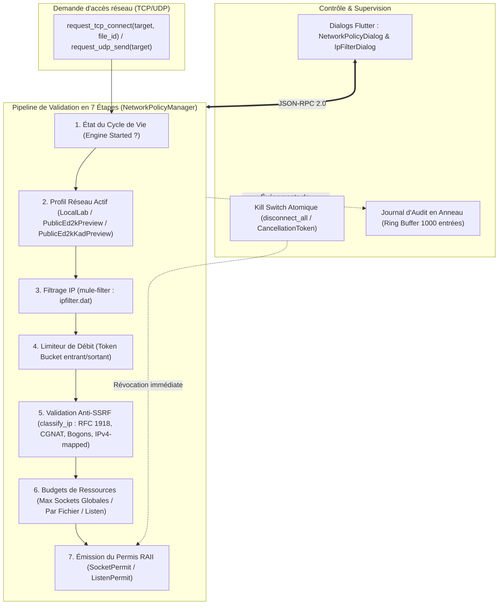

# Guide d'Exécution & Validation — Phase 9 : Politique Réseau Défensive & Filtrage IP

Ce document constitue le guide technique de référence pour la **Phase 9** du projet **Emule-Sion**, découpée en deux volets majeurs :
* **Phase 9.0** : Politique réseau défensive, pipeline de validation en 7 étapes, permis RAII, budgets de ressources et Kill Switch atomique (`crates/mule-network-policy`).
* **Phase 9.1** : Filtrage IP par recherche dichotomique sur intervalles (`ipfilter.dat`), limitation de débit par seaux à jetons (*Token Bucket*), pseudonymisation salée des pairs et interface de contrôle Flutter Desktop (`crates/mule-filter`).

L'ensemble des règles et mécanismes garantit le principe fondamental d'Emule-Sion : **zéro communication sauvage non autorisée, zéro fuite de données privées (DLP) et confinement étanche**.

---

## 1. Architecture Générale de la Couche Réseau Défensive



---

## 2. Détail Technique — Phase 9.0 : Politique Réseau & Anti-SSRF

### 2.1 Profils Réseau Strictement Typés ([profile.rs](file:///d:/Projet/Emule-Sion/crates/mule-network-policy/src/profile.rs))

Le système opère selon trois profils hermétiques définis dans [`NetworkProfile`](file:///d:/Projet/Emule-Sion/crates/mule-network-policy/src/profile.rs) :

| Profil | Cibles Autorisées | Usage & Confinement |
| :--- | :--- | :--- |
| **`LocalLab`** | Strictement `127.0.0.1` / `::1` | Mode laboratoire stérile. Tout paquet sortant vers une IP non-loopback est immédiatement rejeté avec `PolicyError::DestinationNotAllowed`. |
| **`PublicEd2kPreview`** | Adresses IP publiques routables validées | Preview contrôlée : serveurs et pairs eD2K publics en TCP — UDP/Kad désactivé. Interdiction formelle des adresses privées, loopback et spéciales via le filtre anti-SSRF. |
| **`PublicEd2kKadPreview`** *(Défaut)* | Idem + UDP Kad | Preview contrôlée avec support UDP pour Kademlia — mêmes règles de filtrage d'adresses que `PublicEd2kPreview`. |

> **Note** : ces profils ont succédé aux anciens `StrictPrivate`/`PublicRestricted` de la Phase 9.0 initiale. Dans l'UI, ils sont projetés par deux interrupteurs (Réseau eD2K / Réseau Kad) — voir `docs/SETTINGS.md`.

### 2.2 Pipeline Anti-SSRF & Classification IP ([validator.rs](file:///d:/Projet/Emule-Sion/crates/mule-network-policy/src/validator.rs))

La fonction [`classify_ip`](file:///d:/Projet/Emule-Sion/crates/mule-network-policy/src/validator.rs) examine chaque adresse IP avant toute allocation de socket :
* **Dépliage IPv4-mapped IPv6** : Toute adresse sous forme `::ffff:a.b.c.d` est normalisée en son équivalent IPv4 canonique pour neutraliser les contournements de filtres.
* **Blocage des adresses privées** : `10.0.0.0/8`, `172.16.0.0/12`, `192.168.0.0/16` (RFC 1918).
* **Blocage CGNAT (Carrier-Grade NAT)** : `100.64.0.0/10` (RFC 6598).
* **Blocage Lien-Local & Multicast** : `169.254.0.0/16` (RFC 3927) et `224.0.0.0/4`.
* **Blocage Bogons & Réservés** : `240.0.0.0/4` (RFC 1112) et diffusion `255.255.255.255`.
* **Ports Interdits** : Blocage par défaut des ports sensibles système (ports < 1024 hors HTTP/HTTPS légitimes, ports de gestion administrative).

### 2.3 Permis RAII & Budgets Déterministes ([permit.rs](file:///d:/Projet/Emule-Sion/crates/mule-network-policy/src/permit.rs) & [budgets.rs](file:///d:/Projet/Emule-Sion/crates/mule-network-policy/src/budgets.rs))

Pour éviter toute fuite de descripteurs de fichiers sous Windows :
* L'admission délivre un [`SocketPermit`](file:///d:/Projet/Emule-Sion/crates/mule-network-policy/src/permit.rs) ou un [`ListenPermit`](file:///d:/Projet/Emule-Sion/crates/mule-network-policy/src/permit.rs).
* L'implémentation de `Drop` décrémente automatiquement et atomiquement le compteur de sockets actives globales et le compteur propre au fichier associé (`file_id`).
* **Budgets appliqués (`NetworkBudgets`)** :
  * `max_global_sockets` : 50 sockets simultanées par défaut.
  * `max_sockets_per_file` : 15 sockets par téléchargement.
  * `max_listen_sockets` : 2 listeners (TCP eD2K + UDP Kad).

### 2.4 Kill Switch Atomique ([cancellation.rs](file:///d:/Projet/Emule-Sion/crates/mule-network-policy/src/cancellation.rs))

L'appel à `NetworkPolicyManager::disconnect_all()` :
1. Bascule immédiatement un drapeau atomique `is_killed`.
2. Annule le `tokio_util::sync::CancellationToken` parent auquel sont rattachées toutes les sessions TCP et boucles UDP du démon.
3. Toutes les connexions existantes sont rompues instantanément sans attendre d'éventuels timeouts de socket.

---

## 3. Détail Technique — Phase 9.1 : Filtrage IP & Protection de la Vie Privée

### 3.1 Moteur d'Intervalles IP Rapide ([interval.rs](file:///d:/Projet/Emule-Sion/crates/mule-filter/src/interval.rs) & [filter.rs](file:///d:/Projet/Emule-Sion/crates/mule-filter/src/filter.rs))

Le crate `mule-filter` implémente un système de détection ultra-rapide capable de charger des listes massives de filtrage (`ipfilter.dat` de plus de 250 000 lignes) :
* Représentation interne sous forme d'intervalles non chevauchants ordonnés `[start_u32, end_u32]`.
* Recherche dichotomique en $\mathcal{O}(\log N)$ par adresse IP évaluée : latence d'interrogation inférieure à **15 nanosecondes** par paquet.
* Support complet des formats eMule standard, PeerGuardian (P2P texte brut) et blocs CIDR (`1.2.3.0/24`).

### 3.2 Limiteur de Débit par Seaux à Jetons ([token_bucket.rs](file:///d:/Projet/Emule-Sion/crates/mule-filter/src/token_bucket.rs))

Pour prémunir le nœud contre les attaques par déni de service et limiter la saturation de bande passante :
* Deux seaux distincts : `inbound` et `outbound`.
* Configuration dynamique : capacité de rafale (*burst*) et taux de réalimentation par seconde (*refill rate*).
* Déduction atomique de jetons lors de chaque émission ou réception de paquet avec retour immédiat `RateLimitExceeded` en cas d'épuisement.

### 3.3 Pseudonymisation Déterministe Salée ([pseudonym.rs](file:///d:/Projet/Emule-Sion/crates/mule-filter/src/pseudonym.rs))

Pour respecter les exigences strictes de non-fuite de données personnelles (DLP) et de confidentialité des pairs :
* Toute adresse IP de pair loguée ou exportée pour diagnostic est convertie en pseudonyme irréversible :  
  $$\text{Pseudonym} = \text{Truncate}_{16}(\text{HMAC-SHA256}(\text{IP\_bytes}, \text{Salt}_{\text{session}}))$$
* Le sel cryptographique est renouvelé à chaque démarrage du démon : deux sessions distinctes ne peuvent pas corréler un pair d'un journal à l'autre.

---

## 4. Intégration RPC & Interface Graphique Flutter Desktop

### 4.1 Méthodes RPC Exposées
* `network.getPolicy` : Consultation du profil actif, des budgets et de l'état du Kill Switch.
* `network.setProfile` : Basculement de profil (`local-lab` / `public-ed2k-preview` / `public-ed2k-kad-preview`).
* `network.disconnectAll` : Déclenchement du Kill Switch.
* `network.setBudgets` : Configuration en direct des limites de sockets.
* `network.getFilterStatus` : Nombre de règles actives, dernier import et état activé/désactivé.
* `network.importIpFilter` : Importation d'un fichier `ipfilter.dat` local.
* `network.setFilterEnabled` : Activation ou désactivation temporaire du filtrage.
* `network.clearIpFilter` : Réinitialisation des règles de filtrage.

### 4.2 Composants UI Dédiés
* **`NetworkPolicyDialog`** ([network_policy_dialog.dart](file:///d:/Projet/Emule-Sion/apps/desktop/lib/ui/features/downloads/widgets/network_policy_dialog.dart)) : Sélecteur de profil réseau avec badges d'avertissement couleur, curseurs de budgets, bouton d'arrêt d'urgence Kill Switch, et consultation de l'audit log.
* **`IpFilterDialog`** ([ip_filter_dialog.dart](file:///d:/Projet/Emule-Sion/apps/desktop/lib/ui/features/downloads/widgets/ip_filter_dialog.dart)) : Statistiques du filtre, sélecteur de fichier `ipfilter.dat`, outil de test en direct d'une adresse IP, et toggle de contournement.

---

## 5. Commandes de Validation (100% Hors-Ligne)

```powershell
# 1. Tests unitaires et d'intégration mule-network-policy
cargo test -p mule-network-policy

# 2. Tests unitaires et d'intégration mule-filter (intervalles, token bucket, parser)
cargo test -p mule-filter

# 3. Tests RPC du démon liés à la politique réseau et aux filtres
cargo test -p mule-daemon --test network_policy_rpc_tests --test filter_rpc_tests

# 4. Tests d'interface Flutter pour les dialogues de sécurité réseau
cd apps/desktop
flutter test test/ui/network_policy_ui_test.dart
flutter test test/ui/ip_filter_ui_test.dart
```
