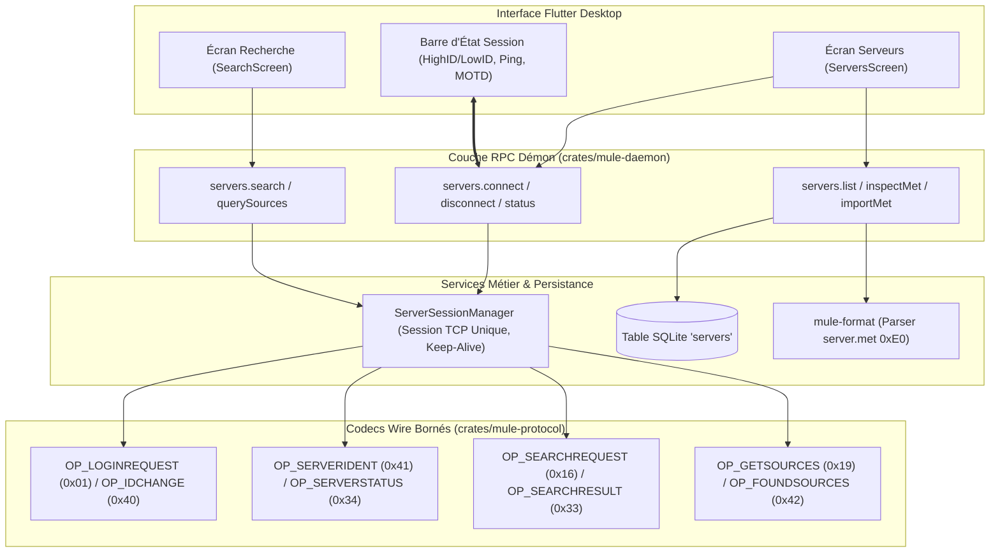
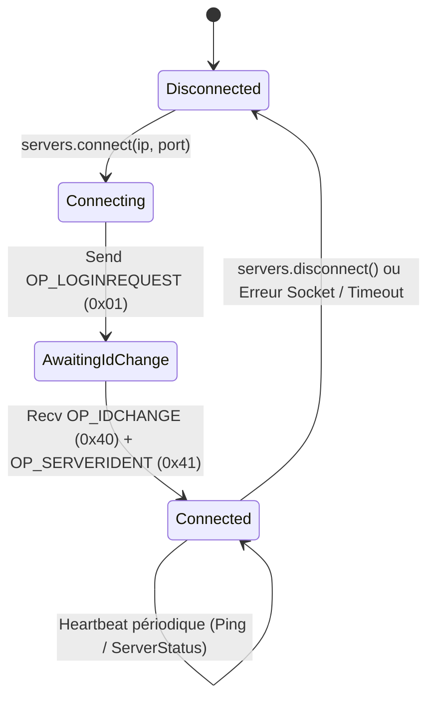

# Guide d'Exécution & Validation — Phase 10 : Infrastructure des Serveurs eD2K

Ce document constitue le guide technique de référence pour la **Phase 10** du projet **eMuleRust**, dédiée à l'intégration complète de la pile client-serveur eD2K :
* **Phase 10.0** : Décodage binaire de fichiers `server.met`, modèle de domaine, persistance SQLite WAL et interface d'administration locale sans sockets externes.
* **Phase 10.1** : Connexion TCP réelle aux serveurs eD2K (Lugdunum / eMule Sunrise), négociation de session, identification, obtention du HighID/LowID et suivi de santé (ping/heartbeat).
* **Phase 10.2** : Moteur de recherche distant sur catalogue serveur et résolution dynamique des sources de téléchargement.

L'ensemble des développements respecte la règle d'or d'eMuleRust : **contrôle total de l'utilisateur, vérification défensive de chaque octet réseau et gestion irréprochable du cycle de vie des sockets**.

---

## 1. Architecture Globale du Sous-Système Serveurs



---

## 2. Phase 10.0 : Annuaire Local, Parser `server.met` & Persistance

### 2.1 Format Binaire `server.met` ([server_met.rs](file:///d:/Projet/eMuleRust/crates/mule-format/src/met/server_met.rs))

Le format historique d'eMule débute par un octet magique `0xE0` suivi du nombre de serveurs encodé sur 32 bits (Little-Endian) :
* Pour chaque serveur :
  * **IP de l'hôte** : 4 octets (Little-Endian).
  * **Port TCP** : 2 octets (Little-Endian).
  * **Nombre de tags de métadonnées** : 4 octets.
  * **Tags TLV** : Nom du serveur (`TAG_SERVER_NAME = 0x01`), Ping (`TAG_SERVER_PING = 0x0C`), Utilisateurs (`TAG_SERVER_USERS = 0x0E`), Fichiers (`TAG_SERVER_FILES = 0x0F`), Description, Préférence.

Le parser [`ServerMetReader`](file:///d:/Projet/eMuleRust/crates/mule-format/src/met/server_met.rs) applique des contrôles stricts anti-déni de service :
* Bornage absolu à 10 000 serveurs par fichier.
* Rejet des tags corrompus avec rapport d'erreurs détaillé.
* Normalisation Unicode NFC des chaînes avec assainissement des caractères de contrôle.

### 2.2 Persistance SQLite ([sqlite/servers.rs](file:///d:/Projet/eMuleRust/crates/mule-core/src/persistence/sqlite/servers.rs))

Les serveurs sont stockés dans la table SQLite `servers` avec gestion de l'unicité sur `(ip, port)` :
* Statut d'activation (`enabled`), préférence (`Low`, `Normal`, `High`), échecs consécutifs (`failed_count`).
* Maintien en cache des métriques : dernier ping, nombre d'utilisateurs et de fichiers rapportés.

---

## 3. Phase 10.1 : Connexion TCP Réelle & Négociation de Session

### 3.1 Machine d'États de Session Serveur ([server_session.rs](file:///d:/Projet/eMuleRust/crates/mule-daemon/src/services/server_session.rs))

Le gestionnaire de session garantit l'invariant : **au plus une connexion serveur active simultanément**.



### 3.2 Paquets Wire Traités ([crates/mule-protocol/src/ed2k/server/](file:///d:/Projet/eMuleRust/crates/mule-protocol/src/ed2k/server/))

| Opcode | Nom | Direction | Description |
| :--- | :--- | :--- | :--- |
| `0x01` | `OP_LOGINREQUEST` | Client $\to$ Serveur | Émission du UserHash, ClientID initial (0), Port TCP d'écoute et nom d'utilisateur. |
| `0x38` | `OP_SERVERMESSAGE` | Serveur $\to$ Client | Message d'accueil (MOTD) ou avertissements légaux du serveur. |
| `0x40` | `OP_IDCHANGE` | Serveur $\to$ Client | Assignation de l'identifiant client final (**ClientID**). |
| `0x41` | `OP_SERVERIDENT` | Serveur $\to$ Client | Identité du serveur : nom canonique, description, version Lugdunum. |
| `0x34` | `OP_SERVERSTATUS` | Serveur $\to$ Client | Télémétrie en direct : nombre total d'utilisateurs connectés et de fichiers indexés. |

### 3.3 Détermination HighID vs LowID

L'adresse IP assignée dans `OP_IDCHANGE` détermine la qualité de connectivité :
* Si $\text{ClientID} \ge 16\,777\,216$ ($0x01000000$) : **HighID** — Le serveur a pu établir une connexion en retour sur notre port TCP entrant. Le client peut communiquer directement avec n'importe quel pair.
* Si $\text{ClientID} < 16\,777\,216$ : **LowID** — Le port TCP entrant est inaccessible depuis l'extérieur (pare-feu ou NAT strict). Les transferts entre deux clients LowID sont impossibles sans relais serveur.

---

## 4. Phase 10.2 : Moteur de Recherche & Résolution de Sources

### 4.1 Recherche de Fichiers Distante ([search.rs](file:///d:/Projet/eMuleRust/crates/mule-protocol/src/ed2k/server/search.rs))

L'envoi de la requête `OP_SEARCHREQUEST` (`0x16`) permet d'interroger la base de données du serveur :
* Expression arborescente encodée en préfixe (opérateurs booléens AND, OR, NOT, filtres de taille minimale/maximale, extensions de fichier).
* Réception en flux de `OP_SEARCHRESULT` (`0x33`) : chaque entrée contient le nom du fichier, la taille exacte en octets, le hash eD2K racine (16 octets) et le nombre de sources complètes et partielles connues.

### 4.2 Requête de Sources auprès du Serveur ([sources.rs](file:///d:/Projet/eMuleRust/crates/mule-protocol/src/ed2k/server/sources.rs))

Dès qu'un téléchargement est actif :
1. Le client émet `OP_GETSOURCES` (`0x19`) en transmettant le hash eD2K (16 octets) et la taille du fichier.
2. Le serveur répond par `OP_FOUNDSOURCES` (`0x42`) : liste d'adresses `IP:port` des pairs hébergeant tout ou partie du fichier.
3. Les sources sont dédupliquées, filtrées contre l'anti-SSRF et l'IPFilter, puis transmises au `SwarmCoordinator`.

---

## 5. Commandes de Validation (100% Hors-Ligne)

```powershell
# 1. Validation du parser de vecteurs server.met
cargo test -p mule-format --test server_met_vectors

# 2. Validation des codecs filaires client-serveur
cargo test -p mule-protocol --test server_codec_tests

# 3. Validation de la persistance SQLite des serveurs
cargo test -p mule-core --test sqlite_servers_tests

# 4. Tests d'intégration de connexion, recherche et sources serveur
cargo test -p mule-daemon --test server_connection_tests --test servers_rpc_tests

# 5. Tests d'interface Flutter pour les écrans Serveurs et Recherche
cd apps/desktop
flutter test test/ui/servers_view_test.dart
flutter test test/ui/servers_connection_test.dart
flutter test test/ui/search_view_test.dart
```
