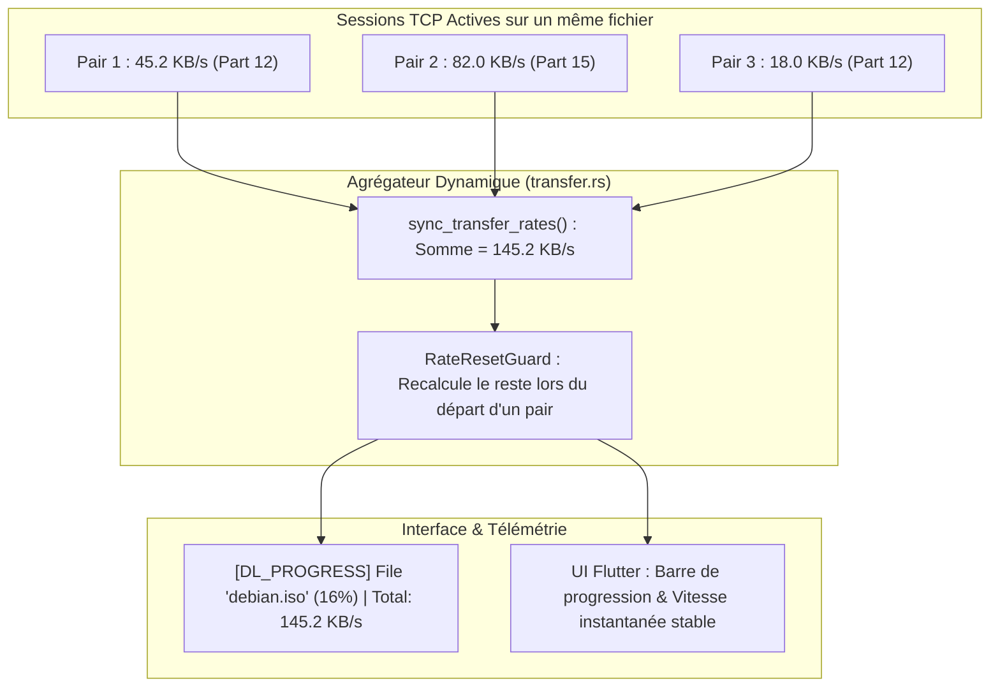

# Guide d'Exécution & Validation — Phase 15 : Téléchargement Multi-Pairs, Queue Ranking eMule & Logs Stratégiques

Ce document constitue le guide technique de référence pour la **Phase 15** (version `v0.1.8`) du projet **EMule-Rust**, dédiée à la stabilisation des transferts en essaim réel, au respect du protocole de file d'attente distant d'eMule et à l'observabilité stratégique du système :
* **Agrégation Multi-Pairs du Débit** : Calcul cumulé en direct de la vitesse de téléchargement globale par fichier (`sync_transfer_rates`) et protection `RateResetGuard` contre les artefacts d'affichage à 0 B/s.
* **Gestion Conforme des Files d'Attente Distantes (Queue Ranking)** : Détection de l'état `Disconnected in queue` préservant le rang de notre client chez les pairs eMule avec délai de réinterrogation conforme (10 à 15 minutes).
* **Stabilité des Quotas du Swarm** : Intégration des pairs en file d'attente dans l'allocateur Water-filling pour maintenir les plafonds de connexion.
* **Gestionnaire de Téléversement (Upload Queue)** : Traitement des requêtes `OP_STARTUPLOADREQ` / `OP_ACCEPTUPLOADREQ` et attribution équitable des slots selon les crédits eMule.
* **Système de Logs Stratégiques** : Standardisation de 5 catégories de télémétrie opérationnelle non polluantes et heartbeat périodique consolidé.
* **Cartographie Complète du Dépôt** : Inventaire exhaustif structuré dans `INDEX.md`.

---

## 1. Agrégation Multi-Pairs du Débit de Téléchargement



### 1.1 Problème Résolu : L'Écrasement du Débit Global
* **Anomalie antérieure** : Chaque session de pair appelait directement `set_download_rate_by_hash(rate)`. Si le Pair A téléchargeait à 150 Ko/s et que le Pair B transmettait un petit paquet de contrôle à 1 Ko/s, la vitesse affichée pour le fichier chutait instantanément à 1 Ko/s, provoquant des oscillations désagréables.
* **Correctif appliqué ([transfer.rs](file:///d:/Projet/EMule-Rust/crates/mule-daemon/src/services/peer_session/transfer.rs))** :
  * `sync_transfer_rates` parcourt l'ensemble des sessions actives rattachées au hash du fichier et additionne leurs débits réels instantanés.
  * `RateResetGuard` est appelé lors de la fermeture d'une session (normale, timeout ou erreur) : il recalcule immédiatement le débit des sessions subsistantes au lieu de forcer brutalement la vitesse à zéro.

---

## 2. Conformité aux Files d'Attente Distantes eMule (Queue Ranking)

Dans le réseau eDonkey2000, un pair eMule officiel dont tous les slots d'upload sont occupés répond par `OP_QUEUERANKING` (`0x60`) pour annoncer notre position dans sa file d'attente (ex: Rang #42).

### 2.1 Déconnexion Normale en File d'Attente (`Disconnected in queue`)
* **Comportement officiel d'eMule** : Pour économiser les descripteurs de sockets TCP, un client eMule ferme couramment la connexion TCP une fois le rang attribué. Il attend que notre client revienne aux nouvelles plus tard.
* **Anomalie antérieure** : Cette fermeture était interprétée à tort comme une panne réseau critique, bannissant la source ou la réinterrogeant agressivement toutes les 60 secondes (ce qui provoquait un bannissement pour flood chez le pair distant).
* **Résolution conforme ([peer_session.rs](file:///d:/Projet/EMule-Rust/crates/mule-daemon/src/services/peer_session.rs))** :
  * La fermeture de socket suite à un `OP_QUEUERANKING` est classifiée comme `Disconnected in queue`.
  * La source conserve son statut valide `Allowed`.
  * Le délai de reconnexion est réglé sur la plage canonique eMule de **10 à 15 minutes**, préservant notre priorité sans pénalité.

### 2.2 Préservation du Plafond Water-Filling ([strategy.rs](file:///d:/Projet/EMule-Rust/crates/mule-daemon/src/services/swarm_coordinator/strategy.rs))
* Les sources dans l'état `Allowed` ou `Tried` (en attente dans une file distante) sont incluses dans le décompte des sources viables.
* Le plafond d'allocation de slots calculé par l'algorithme Water-filling ne s'effondre plus, évitant les à-coups dans la gestion de l'essaim.

---

## 3. Gestionnaire de Téléversement & Dispatcher Entrant

Le service [`crates/mule-daemon/src/services/upload_queue.rs`](file:///d:/Projet/EMule-Rust/crates/mule-daemon/src/services/upload_queue.rs) implémente la réciprocité de partage :
* Réception de `OP_STARTUPLOADREQ` (`0x54`) via le dispatcher d'écoute entrante.
* Si des slots d'upload sont disponibles : émission immédiate de `OP_ACCEPTUPLOADREQ` (`0x55`).
* Sinon : placement du pair dans la file d'attente pondérée par ses crédits eMule accumulés (`[UPLOAD_QUEUED]`), calcul de son rang et émission de `OP_QUEUERANKING`.
* À la libération d'un slot (`[UPLOAD_RELEASED]`), le pair en tête de file est automatiquement promu (`[UPLOAD_PROMOTED]`).

---

## 4. Système de Logs Stratégiques en 5 Catégories

Afin d'offrir une visibilité immédiate sans saturer la console de milliers de lignes de blocs unitaires, les logs ont été restructurés selon 5 préfixes normalisés :

| Préfixe de Log | Déclencheur & Fréquence | Exemple de Message |
| :--- | :--- | :--- |
| **`[PART_COMPLETED]`** | Complétion d'une partie de 9,28 Mo | `[PART_COMPLETED] File 'archive.iso': Part 3/10 downloaded & verified. Progress: 30.0%` |
| **`[DL_PROGRESS]`** | Synthèse toutes les 10s par fichier actif | `[DL_PROGRESS] File 'archive.iso' (30.0% - 27.8/92.8 MB) \| Rate: 245.2 KB/s \| Active peer: 88.190.22.11:4662` |
| **`[KAD_SEARCH]`** | Fin d'une recherche Kad | `[KAD_SEARCH] SearchSources finished: 18 candidate responses -> 6 new unique sources persisted` |
| **`[UPLOAD_...]`** | Événements d'upload & file d'attente | `[UPLOAD_SLOT_GRANTED] Client 91.121.4.3:4662 granted active upload slot for file 'doc.pdf'` |
| **`[SYSTEM_HEARTBEAT]`** | Synthèse globale toutes les 60s | `[SYSTEM_HEARTBEAT] Server: Connected \| Kad: Running (420 contacts) \| DL: 2 active (342 KB/s) \| UL: 1 active` |

---

## 5. Cartographie Globale du Dépôt (`INDEX.md`)

Le fichier racine [`INDEX.md`](file:///d:/Projet/EMule-Rust/INDEX.md) a été créé pour offrir un répertoire complet et documenté de l'ensemble des composants du projet :
* Documentation des crates Rust (`mule-core`, `mule-protocol`, `mule-daemon`, `mule-mcp`, `mule-format`, `mule-filter`, `mule-network-policy`).
* Organisation de l'application Flutter Desktop (`apps/desktop/lib/`).
* Emplacement et rôle des scripts d'automatisation, des tests d'intégration et des spécifications formelles.

---

## 6. Commandes de Validation (100% Hors-Ligne)

```powershell
# 1. Validation de l'agrégation de vitesse et des transferts multi-pairs
cargo test -p mule-daemon --test swarm_dual_peer_tests

# 2. Validation de la file d'upload et des requêtes entrantes
cargo test -p mule-daemon --test upload_inbound_tests

# 3. Vérification de non-régression sur la totalité des 204+ tests Rust du workspace
cargo test --workspace

# 4. Vérification de l'analyse statique Flutter Desktop
cd apps/desktop
flutter analyze
flutter test
```
