# Rapport Détaillé : Architecture & État d'Avancement du Projet Emule-Sion

**Projet :** Emule-Sion  
**Date :** 19 Septembre 2026  
**Version Workspace :** `v0.1.8` (Desktop `v0.1.8+1`)  
**Auteurs :** Analyse d'ingénierie logicielle & architecture système  
**Statut :** Document d'audit et de synthèse technique mis à jour

---

## 1. Introduction & Vision du Projet

**Emule-Sion** est une réimplémentation moderne, modulaire et hautement sécurisée des protocoles historiques de partage pair-à-pair **eD2K (eDonkey2000)** et de table de hachage distribuée **Kademlia (Kad DHT)**, ainsi qu'un écosystème outillé pour les agents IA via le protocole **MCP (Model Context Protocol)**.

Le système est architecturé en trois composantes majeures :
1. **Un moteur bas niveau en Rust (`crates/`)** : gestionnaire de stockage éparse, codecs filaires bornés, machine d'états protocolaire, démon local asynchrone (Tokio), swarm dynamique équitable (water-filling), routage DHT Kad v2 avec métrique numérique 128-bit, persistance SQLite WAL, politique réseau défensive en 7 couches avec anti-SSRF et limitation de débit.
2. **Une interface graphique de bureau en Flutter Desktop (Windows)** : interface réactive Clean Architecture (MVVM), ergonomique et modulaire connectée au démon via une liaison bidirectionnelle WebSocket JSON-RPC 2.0.
3. **Un serveur d'outils d'agent IA (`mule-mcp`)** : serveur MCP natif exposant l'intégralité du contrôle d'Emule-Sion (téléchargements, swarm, serveurs, Kad DHT, upload/shares, identité et politique réseau) sous forme d'outils invocables par des assistants IA.

### 1.1 Philosophie Fondamentale : Confinement & Déterminisme de Laboratoire

Le projet s'est construit autour d'une règle d'ingénierie stricte :
* **Isolation loopback (`127.0.0.1`) par défaut** : aucune socket ne communique avec des réseaux publics non contrôlés à moins d'un basculement explicite de profil réseau. Les procédures de test, d'injection et de qualification sont 100 % reproductibles hors-ligne.
* **Paliers de validation (Tiers d'Interopérabilité)** :
  * **Tier 1 (Corpus statique)** : validation déterministe sur flux d'octets figés réels.
  * **Tier 2 (Pair de référence émulé)** : validation dynamique du handshake, des statuts et du transfert de blocs face à un pair simulé en loopback hermétique.
  * **Tier 3 (Binaire officiel épinglé)** : validation face au binaire officiel eMule 0.50a exécuté en boucle locale stérile.
* **Garantie Zéro-Fuite & Confidentialité** : anonymisation systématique des chemins hôtes et adresses IP publiques dans les logs et exports, normalisation Unicode NFC avec neutralisation des caractères bidirectionnels trompeurs (anti-spoofing).

---

## 2. Architecture Globale du Système

### 2.1 Schéma Architectural d'Ensemble

```mermaid
flowchart TB
    subgraph UI ["Interface Utilisateur (apps/desktop - Flutter Desktop)"]
        FlutterApp["Application Flutter Desktop (Win64)"]
        UI_Downloads["Module Téléchargements & Part Map"]
        UI_Servers["Module Serveurs eD2K"]
        UI_Kad["Module Kad DHT & Buckets"]
        UI_Search["Module Recherche Unifiée (Serveurs & Kad)"]
        UI_History["Module Historique & Stats"]
        UI_Settings["Module Paramètres & Politiques"]
        Supervisor["DaemonSupervisor (Process & Session Watcher)"]
        RpcClient["RpcDaemonClient (WebSocket JSON-RPC 2.0)"]
        MockClient["FakeDaemonClient (Mode Hors-Ligne Mock)"]
    end

    subgraph AGENTS ["Écosystème Agents IA (crates/mule-mcp)"]
        MCPServer["Serveur MCP (Stdio JSON-RPC)"]
        MCPTools["60+ Outils MCP (Downloads, Swarm, Kad, Servers, Shares, System)"]
    end

    subgraph IPC ["Liaison Locale IPC (127.0.0.1:4660)"]
        WS["WebSocket JSON-RPC 2.0 (/ws)"]
        Lock["Verrou d'instance exclusif fs4 (mule.lock)"]
        Auth["Jeton CSPRNG 64 car. (auth.token)"]
        Session["Découverte de session atomique (session.json)"]
    end

    subgraph DAEMON ["Démon Central (crates/mule-daemon - Tokio Asynchrone)"]
        AxumServer["Serveur HTTP / WebSocket (Axum)"]
        State["AppState (Gestion d'état global partagé)"]
        
        subgraph Services ["Services Métier Découpés (Clean Architecture)"]
            DownloadSvc["DownloadService\n(Pipeline Téléchargement, AICH, PartFiles)"]
            SwarmAlloc["SwarmAllocator\n(Water-Filling Max-Min Fair Share)"]
            SwarmCoord["SwarmCoordinator\n(Orchestration & Auto-Discovery)"]
            PeerMgr["PeerSessionManager\n(Sessions TCP, Handshake, SX1/SX2, Transferts zlib)"]
            ServerMgr["ServerSessionManager\n(Session TCP Serveur eD2K, Ping, Recherche)"]
            InboundListener["InboundListenerService\n(Serveur TCP Entrant, Dispatcher & SX)"]
            UploadMgr["UploadManager & Queue\n(File d'Attente, Slots & Crédits)"]
            KadSvc["KadService\n(Table DHT, Lookups Itératifs & Convergence)"]
            KadUdp["KadUdpService\n(Transport UDP, RateLimiter & Transactions)"]
            UpnpSvc["UpnpService\n(Mappage de ports IGD WAN, Refresh périodique)"]
            IdentitySvc["IdentityService\n(UserHash, ClientID, RSA Crypto)"]
        end
    end

    subgraph CRATES ["Bibliothèques Métier Spécialisées"]
        MulePolicy["mule-network-policy\n(7 couches, Permits RAII, Kill Switch, Anti-SSRF)"]
        MuleFilter["mule-filter\n(IPFilter, Token Bucket, Pseudonymisation)"]
        MuleProtocol["mule-protocol\n(Codecs bornés, SX1/SX2, Kad v2, RC4/DH Obfuscation)"]
        MuleCore["mule-core\n(PartFile, RangeSet, KBucketTable, SQLite WAL)"]
        MuleFormat["mule-format\n(MD4/AICH, server.met, nodes.dat, .part.met)"]
    end

    subgraph Storage ["Stockage & Persistance"]
        SQLite["mule.db (Base de données SQLite WAL)"]
        PartFiles["data/temp/*.part (Fichiers partiels éparses)"]
        FinalDir["downloads/* (Fichiers promus atomiquement)"]
    end

    FlutterApp --> UI_Downloads & UI_Servers & UI_Kad & UI_Search & UI_History & UI_Settings
    FlutterApp --> Supervisor
    Supervisor --> RpcClient
    RpcClient -.->|Mode Dégradé/Dev| MockClient
    RpcClient <==>|JSON-RPC 2.0 sur 127.0.0.1:4660| WS
    Supervisor -.-> Lock & Auth & Session

    MCPServer --> MCPTools
    MCPTools <==>|Client RPC interne| WS

    WS <==> AxumServer
    AxumServer --> State
    State --> Services

    DownloadSvc --> MuleCore
    SwarmCoord --> SwarmAlloc & PeerMgr & DownloadSvc
    PeerMgr --> MuleProtocol & MulePolicy
    ServerMgr --> MuleProtocol & MulePolicy
    InboundListener --> MuleProtocol & MulePolicy & UploadMgr
    KadSvc --> KadUdp & MuleCore
    KadUdp --> MuleProtocol & MulePolicy
    MulePolicy --> MuleFilter

    DownloadSvc --> PartFiles & FinalDir & SQLite
    KadSvc --> SQLite
    ServerMgr --> SQLite
```



---

## 3. Détail des Modules et Bibliothèques (Crates)

### 3.1 `crates/mule-format` — Hachage, Parsers de Formats & Liens
Ce crate est exempt de toute logique réseau. Il assure la manipulation des structures de données et des formats binaires officiels du réseau eDonkey2000 :
* **Hachage Cryptographique eD2K** : implémentation optimisée de l'algorithme MD4 par blocs contigus de 9 728 000 octets (9 500 KiB) et calcul du hash racine combiné.
* **Arbres AICH (Advanced Intelligent Corruption Handling)** : découpage hiérarchique en sous-blocs de 180 KiB vérifiés par hachage SHA-1.
* **Résolveur d'URIs `ed2k://`** : parsing et génération de liens canoniques (nom, taille, hash racine, sources AICH optionnelles).
* **Décodeurs et Encodeurs de Fichiers Métadonnées** :
  * `server.met` : liste des serveurs d'indexation eD2K avec tags de métadonnées.
  * `nodes.dat` : contacts Kademlia (formats v0, v1 et v2) avec contrôle de bornes strictes ($\le 5\text{ Mo}$, $\le 10\,000$ contacts).
  * `.part.met` : import défensif des fichiers d'état d'eMule (formats standard `0xE0`, grands fichiers `0xE1`, récents `0xE2`), avec inversion algorithmique des lacunes (*gaps*) pour reconstituer les plages valides.
  * `ipfilter.dat` : importation des plages CIDR d'adresses IP bloquées.

### 3.2 `crates/mule-protocol` — Codecs Réseau Bornés, Obfuscation & Machines d'États
Ce composant contient la logique filaire pure et garantit l'intégrité de l'analyse des paquets. Récemment refactorisé en sous-modules spécialisés (`framing/`, `ed2k/`, `kad/`, `lab/`) :
* **Codecs eD2K Pair-à-Pair (`ed2k/`)** :
  * Trame TCP bornée avec magic bytes (`PR_EDONKEY = 0xE3`, `PR_EMULE = 0xC5`).
  * Opcodes supportés : `OP_HELLO`, `OP_HELLO_ANSWER`, `OP_OFFERFILES`, `OP_REQFILENAME`, `OP_SETREQFILEID`, `OP_FILESTATUSREQ`, `OP_FILESTATUS` (bitfield et sources complètes), `OP_REQUESTPARTS`, `OP_SENDINGPART`, `OP_COMPRESSEDPART` (décompression zlib en flux), `OP_END_OF_DOWNLOAD`, `OP_QUEUERANKING`, etc.
  * **Échange de Sources v1 & v2 (`source_exchange/`)** : implémentation complète des requêtes et réponses `OP_REQUESTSOURCES` / `OP_ANSWERSOURCES` et `OP_REQUESTSOURCES2` / `OP_ANSWERSOURCES2` avec filtrage CIDR et validation des capacités pairs via `misc_options1` et `misc_options2`.
* **Codecs eD2K Serveur (`ed2k/server/`)** :
  * Gestion complète des messages client-serveur : `OP_LOGINREQUEST`, `OP_SERVERSTATUS`, `OP_SEARCHREQUEST`, `OP_SEARCHRESULT`, `OP_GETSOURCES`, `OP_FOUNDSOURCES`.
* **Codecs Kad DHT (`kad/`)** :
  * Encapsulation UDP sous `PR_KADEMLIA = 0xE4` et `PR_KADEMLIA_PACKED = 0xE5`.
  * Décodage et encodage séparés (`kad/decoder/`, `kad/encoder.rs`, `kad/types.rs`, `kad/opcodes.rs`).
  * Résolution des collisions de trames sur `OP_KADEMLIA2_SEARCH_RES` (0x3B) entre résultats de mots-clés et sources.
  * Messages DHT : Ping/Pong (`0x60`/`0x61`), Hello (`0x11`/`0x19`), Bootstrap (`0x00` legacy, `0x21`/`0x29` Kad v2), FindNode, Search/Publish Sources & Keywords.
* **Obfuscation Protocolaire (`ed2k/obfuscation/`)** :
  * Échange de clés Diffie-Hellman 768 bits (RFC 2409 groupe MODP 1) pour serveurs et pairs.
  * Chiffrement par flux RC4 (`drop_bytes(1024)`) et dérivation de clés MD5 conforme aux spécifications officielles eMule.
* **Profils de Compatibilité Explicites** :
  * `Emule050a`, `Amule233`, `LegacyEdonkey`, `UnknownStrict`.

### 3.3 `crates/mule-core` — Modèle de Domaine, Stockage Éparse & Persistance
* **Moteur de Stockage (`storage/part_file.rs`, `storage/finalizer.rs`)** :
  * Fichiers partiels `.part` alloués de manière éparse (*sparse files*).
  * Gestionnaire d'intervalles `RangeSet` : calcul précis des trous, écritures de blocs résiduels.
  * Promotion atomique : vérification du hash MD4 global puis renommage atomique vers `downloads/`.
* **Table de Routage Kademlia (`kad/`)** :
  * Identifiant 128 bits (`KadId`) avec distance métrique numérique conforme à eMule `CUInt128` (comparaison en entiers DWORDs avec `leading_zeros` pour le calcul précis de distance).
  * 128 buckets de capacité $K = 20$ contacts actifs + cache de 10 remplaçants (éviction LRU).
* **Persistance SQLite WAL (`persistence/sqlite/`)** :
  * Tables : `downloads`, `download_categories`, `download_history`, `servers`, `peer_sources`, `kad_contacts`, `kad_sources_index`, `kad_keywords_index`, `shared_files`, `credits`.

### 3.4 `crates/mule-network-policy` — Politique Réseau Défensive & Anti-SSRF
* **Pipeline de validation en 7 étapes (`request_tcp_connect`)** :
  1. État du cycle de vie du moteur.
  2. Profil de réseau actif (`LocalLab`, `StrictPrivate`, `PublicRestricted`).
  3. Filtrage IP contre les plages interdites.
  4. Limitation de débit par seau à jetons (*Token Bucket*).
  5. Validation anti-SSRF : blocage des adresses privées (RFC 1918), CGNAT (RFC 6598 100.64/10), lien local (RFC 3927), bogons (240/4) et dépliage des adresses IPv4-mappées-IPv6.
  6. Budgets de ressources (nombre max de sockets globales, pairs par fichier, sockets d'écoute).
  7. Émission d'un permis RAII (`SocketPermit`, `ListenPermit`).
* **Kill Switch Atomique** : `disconnect_all()` coupe immédiatement toutes les sockets via `CancellationToken`.

### 3.5 `crates/mule-filter` — Filtres IP & Pseudonymisation
* Structure de recherche d'intervalles d'IP ultra-rapide (CIDR / début-fin) pour chargement d'archives `ipfilter.dat`.
* Limiteurs Token Bucket entrants et sortants.
* Pseudonymisation déterministe salée pour traçage des pairs sans compromettre leur vie privée.

### 3.6 `crates/mule-daemon` — Démon Asynchrone Tokio & Serveur RPC
Refactorisé selon une architecture modulaire propre :
* **Découpage des Handlers RPC (`rpc/handlers/`)** :
  * Handlers spécialisés par domaine : `downloads.rs`, `servers.rs`, `kad.rs`, `sources.rs`, `shares.rs`, `history.rs`, `categories.rs`, `network.rs`, `settings.rs`, `upnp.rs`, `lab.rs`.
* **Services Découpés (`services/`)** :
  * `swarm_allocator.rs` : algorithme **Weighted Max-Min Fair-Share Water-filling** distribuant dynamiquement les connexions pairs entre fichiers selon leur priorité et rareté.
  * `swarm_coordinator/` : orchestration d'essaim multi-sources, auto-découverte cadencée (30s / 60s / 300s), calcul dynamique du débit global agrégé par fichier.
  * `peer_session/` : découpé en `connection.rs`, `handshake.rs`, `status_query.rs`, `source_exchange.rs`, `transfer.rs`.
  * `inbound_listener/` : écoute TCP entrante, `connection.rs`, `dispatcher.rs` pour traiter `OP_HELLO`, `OP_REQUESTPARTS`, `OP_REQUESTSOURCES` entrants.
  * `upload_queue.rs` : file d'attente d'upload avec gestion de rangs, slots actifs et comptabilisation des crédits.
  * `kad/` & `kad_udp/` : routage itératif avec convergence vers `SEARCHTOLERANCE` (0x01000000), timeout UDP optimisé à 3s, détection endianness wire des adresses IPv4.
  * `upnp/` : découverte IGD, mappage automatique TCP/UDP et renouvellement périodique toutes les 45 minutes avec retries exponentiels.
  * `identity.rs` : gestion de l'UserHash, génération et validation des signatures RSA.

### 3.7 `crates/mule-mcp` — Serveur Model Context Protocol (MCP)
* Serveur dédié pour interfaces agents IA (Claude Desktop, Cursor, Antigravity, etc.) communiquant via stdio en JSON-RPC.
* Plus de 60 outils exposés couvrant :
  * Téléchargements : `emule_list_downloads`, `emule_add_link`, `emule_pause_download`, `emule_resume_download`, `emule_remove_download`, `emule_set_destination`, `emule_download_set_category`, `emule_retry_download`, `emule_inspect_part_met`, `emule_import_part_met`.
  * Swarm & Sources : `emule_list_sources`, `emule_add_manual_source`, `emule_connect_source`, `emule_disconnect_source`, `emule_clear_sources`, `emule_swarm_status`.
  * Serveurs : `emule_list_servers`, `emule_connect_server`, `emule_disconnect_server`, `emule_update_servers_from_url`, `emule_inspect_server_met`, `emule_import_server_met`, `emule_search`, `emule_query_server_sources`.
  * Kad DHT : `emule_kad_status`, `emule_kad_bootstrap`, `emule_kad_start_udp`, `emule_kad_stop_udp`, `emule_kad_ping`, `emule_kad_find_node`, `emule_kad_list_contacts`, `emule_kad_search_sources`, `emule_kad_publish_source`, `emule_kad_publish_keywords`, `emule_kad_import_nodes_dat`.
  * Partages & Uploads : `emule_list_shares`, `emule_add_share`, `emule_remove_share`, `emule_list_uploads`, `emule_cancel_upload`, `emule_start_listener`, `emule_stop_listener`, `emule_listener_status`.
  * Sécurité & Réseau : `emule_get_network_policy`, `emule_set_network_profile`, `emule_network_disconnect_all`, `emule_import_ip_filter`, `emule_set_network_budgets`, `emule_upnp_status`, `emule_upnp_map_ports`, `emule_get_identity`, `emule_rotate_identity`, `emule_list_credits`.

### 3.8 `apps/desktop` — Interface Utilisateur Flutter Desktop Windows
Développée en Clean Architecture et MVVM (`v0.1.7+1`) :
* **Téléchargements** : Part Map interactive bloc par bloc (9,28 Mo) avec tooltips d'offset, métriques de vitesse en direct (calculée et synchronisée avec le débit agrégé du swarm), glisser-déposer de `.part.met`, gestion de catégories.
* **Recherche Unifiée** : sélecteur bi-moteur (*Serveurs eD2K* / *Réseau Kad DHT*), filtres de taille et ajout direct aux téléchargements.
* **Serveurs** : état de connexion, import de listes `server.met`, ping de latence et interrogation de sources.
* **Kad DHT** : tableau de bord temps réel, ID Kad local, paquets RX/TX, jauge d'activité des 128 buckets, table des contacts avec ping RTT, panneau d'amorçage bootstrap et import `nodes.dat`.
* **Historique & Statistiques** : événements de téléchargement, visualisations agrégées sur 4 fenêtres temporelles, politique de purge automatique et exports caviardés JSON/CSV.
* **Supervision du Démon (`DaemonSupervisor`)** : démarrage automatique de `mule-daemon.exe`, reconnexion résiliente avec backoff exponentiel, mode mock hors-ligne (`FakeDaemonClient`).

---

## 4. Historique Détaillé des Versions & Jalons Validés

| Version / Jalon | Date | Principales Réalisations | Statut de Validation |
| :--- | :--- | :--- | :--- |
| **v0.1.0-lab** | 13/09/2026 | Codec eD2K initial, boucle de stockage RangeSet, démon Rust + UI Flutter, verrou fs4, attestation Tier 1 (100%) et Tier 2 (100%), harnais Tier 3. | ✅ Validé (235 tests totaux) |
| **v0.1.1-lab** | 14/09/2026 | Cascade déterministe du Workdir (portable.flag, etc.), double verrouillage du mode lab, taxonomie d'erreurs JSON-RPC 2.0 (-32000..-32010), politique PowerShell RemoteSigned. | ✅ Validé & Scellé |
| **v0.1.2-lab** | 14/09/2026 | Séparation hermétique `data/` et `downloads/`, persistance SQLite des suppressions, sonde d'écriture (write-probe), pipeline QA E2E automatisé. | ✅ Validé & Scellé |
| **v0.1.3-lab** | 15/09/2026 | **Interopérabilité eMule 0.50a (Tier 3.1 à 3.6)** : handshake complet, file status bitfields, transfert de blocs 9.28 Mo avec résidu, reprise après crash. **Phase 8** : Part Map interactive, historique local & stats, catégories hiérarchiques, import défensif `.part.met`. Packaging Windows standard et qa-loopback. | ✅ Certifié (151 tests Rust, 74 tests Flutter) |
| **v0.1.4** | 16/09/2026 | Swarm multi-sources initial, fallback d'obfuscation RC4/DH, conformité DLP & audit réseau, expansion des messages Kad DHT. | ✅ Validé & Mergé |
| **v0.1.5** | 17/09/2026 | Allocateur dynamique de swarm (**Weighted Max-Min Fair-Share**), démarrage basse latence des téléchargements (intervalles d'auto-découverte 30s/60s/300s), interopérabilité Kad legacy (`KADEMLIA_BOOTSTRAP_REQ_OLD`), polling Kad dans l'UI Flutter. | ✅ Validé & Mergé |
| **v0.1.6** | 18/09/2026 | **Source Exchange v4 (SX1 & SX2)** : échange de sources pair-à-pair complet. **Gestion des blocs compressés** : décompression zlib en continu (`OP_COMPRESSEDPART`). **Intégration MCP (`mule-mcp`)** : crate dédié avec 60+ outils MCP pour assistants IA. | ✅ Validé & Mergé |
| **v0.1.7** | 19/09/2026 | **Convergence Recherche Kad DHT** : métrique de distance numérique DWORDs (CUInt128), endianness IP wire corrigée, convergence itérative vers `SEARCHTOLERANCE` (0x01000000), résolution collision d'opcodes sur 0x3B, timeout UDP optimisé (3s). **Refactorisation Clean Architecture** : éclatement modulaire de `mule-daemon`, `mule-protocol`, `mule-core`, `mule-mcp`. | ✅ Validé & Mergé |
| **v0.1.8** *(Actuel)* | 19/09/2026 | **Téléchargement Multi-Pairs & Swarm eMule** : agrégation des débits en direct (`sync_transfer_rates`), gestion conforme des files d'attente distantes (`Disconnected in queue` avec re-ask à 10–15m), protection du plafond de quota water-filling, dispatcher de téléversement (`OP_STARTUPLOADREQ`, `OP_ACCEPTUPLOADREQ`). **Cartographie** : inventaire exhaustif `INDEX.md`. | ✅ Compilé, testé et validé en conditions réelles |

---

## 5. État Actuel du Code & Modifications Récentes

### 5.1 Synthèse de la Refactorisation Clean Architecture (v0.1.7)
Le projet a bénéficié d'une profonde restructuration architecturale afin d'assurer une séparation stricte des responsabilités et une maintenabilité optimale :
* **`mule-daemon`** :
  * Les monolithiques `methods.rs` et `services/` ont été divisés en modules de domaine autonomes : `rpc/handlers/` (categories, downloads, history, kad, lab, network, servers, settings, shares, sources, upnp) et `services/` (découpage de `peer_session/`, `inbound_listener/`, `downloads/`, `kad/`, `kad_udp/`, `upnp/`, `swarm_coordinator/`).
* **`mule-protocol`** :
  * Codecs divisés en `framing/`, `ed2k/` (avec sous-dossiers `decoder/`, `encoder/`, `obfuscation/`, `session/`, `sequencer/`, `server/`, `source_exchange/`, `storage/`) et `kad/` (`decoder/`, `encoder.rs`, `types.rs`, `opcodes.rs`).
* **`mule-mcp`** :
  * Découpage des outils MCP par domaine fonctionnel (`tools/downloads/`, `tools/shares/`, `tools/kad.rs`, `tools/servers.rs`, `tools/system.rs`).

### 5.2 Améliorations Récentes dans le Working Tree
* **Synchronisation du Débit de Téléchargement Global (`transfer.rs`)** :
  * Le débit affiché pour un fichier n'est plus écrasé par la dernière session de pair inactive ; il est calculé comme la somme des débits instantanés de toutes les sessions actives pour ce fichier (`sync_transfer_rates`).
  * Logs périodiques de progression clairs toutes les 10 secondes : `[DL_PROGRESS] File '...' (XX% - XX/XX MB) | Total Rate: XX KB/s`.
* **Détection Fine des Capacités de Source Exchange (`peer_info.rs`)** :
  * Prise en compte de la version de Source Exchange annoncée dans `misc_options1` (bits 12..15) en plus de `emule_info`.
* **Écoute Entrante & Dispatcher (`inbound_listener/dispatcher.rs`)** :
  * Gestion complète et robuste des requêtes `OP_REQUESTSOURCES` et `OP_REQUESTSOURCES2` sur les connexions entrantes avec vérification des fichiers partagés et des téléchargements locaux.

---

## 6. Bilan de Sécurité & Robustesse Réseau

Toutes les exigences issues de l'audit de sécurité des connexions réseau ont été appliquées et consolidées :

1. **Couche eD2K (TCP)** :
   * Identité réelle du client (`user_hash`, `client_id`) propagée avec drapeaux de chiffrement.
   * Protection mémoire avec taille maximale de buffer de lecture (`MAX_READ_BUFFER_SIZE`).
   * Déconnexion atomique sans blocage de port (`EADDRINUSE`) grâce à l'attente explicite du join handle de la tâche d'écoute.
   * Concurrence garantie via `AtomicBool` sur l'état d'écoute.

2. **Couche Kademlia (UDP)** :
   * Filtrage immédiat de chaque datagramme entrant contre la politique anti-SSRF (`classify_ip`) et l'IPFilter.
   * Limiteur de débit par IP (`IpRateLimiter`) empêchant l'utilisation d'Emule-Sion comme réflecteur d'attaque par déni de service (DRDoS).
   * Bornage strict du conteneur des transactions en vol avec purge automatique après timeout de 3 secondes.

3. **Couche UPnP IGD & WAN** :
   * Tâche de rafraîchissement périodique automatique toutes les 45 minutes avec retries progressifs.
   * Validation de l'adresse IP WAN externe : rejet formel des adresses privées (RFC 1918), loopback et CGNAT (RFC 6598 `100.64.0.0/10`).
   * Protection anti-Rogue IGD : passerelle IGD acceptée uniquement si située dans les sous-réseaux locaux légitimes.

---

## 7. Inventaire des Outils & Intégration IA (MCP)

Le projet dispose d'une suite complète de plus de 60 outils MCP intégrés (`crates/mule-mcp`), permettant à des agents autonomes d'administrer, surveiller et interagir avec l'application :

| Domaine MCP | Outils Principaux | Description |
| :--- | :--- | :--- |
| **Système & Paramètres** | `emule_status`, `emule_get_settings`, `emule_update_settings`, `emule_set_limits`, `emule_shutdown` | Surveillance globale, mise à jour des quotas, configuration dynamique. |
| **Téléchargements** | `emule_list_downloads`, `emule_add_link`, `emule_pause_download`, `emule_resume_download`, `emule_remove_download`, `emule_set_destination`, `emule_download_set_category`, `emule_inspect_part_met`, `emule_import_part_met` | Pilotage complet du cycle de vie des téléchargements et fichiers partiels. |
| **Swarm & Sources** | `emule_list_sources`, `emule_add_manual_source`, `emule_connect_source`, `emule_disconnect_source`, `emule_swarm_status` | Inspection et gestion fine de l'essaim de pairs. |
| **Serveurs eD2K** | `emule_list_servers`, `emule_connect_server`, `emule_disconnect_server`, `emule_search`, `emule_query_server_sources`, `emule_update_servers_from_url` | Recherche et gestion de l'annuaire de serveurs eD2K. |
| **Kad DHT** | `emule_kad_status`, `emule_kad_bootstrap`, `emule_kad_ping`, `emule_kad_find_node`, `emule_kad_list_contacts`, `emule_kad_search_sources`, `emule_kad_publish_source`, `emule_kad_publish_keywords` | Contrôle et recherche distribuée sur la table DHT Kademlia. |
| **Partages & Upload** | `emule_list_shares`, `emule_add_share`, `emule_remove_share`, `emule_list_uploads`, `emule_start_listener`, `emule_stop_listener`, `emule_listener_status` | Gestion des fichiers partagés et du serveur d'écoute entrant. |
| **Sécurité & Politique** | `emule_get_network_policy`, `emule_set_network_profile`, `emule_network_disconnect_all`, `emule_import_ip_filter`, `emule_set_network_budgets`, `emule_upnp_status`, `emule_get_identity`, `emule_rotate_identity`, `emule_list_credits` | Contrôle du confinement, kill switch, IPFilter et gestion cryptographique. |

---

## 8. Commandes de Validation & État des Tests

Toutes les vérifications s'exécutent de manière reproductible et hors-ligne :

```powershell
# 1. Compilation du workspace complet (Rust v0.1.7)
cargo check --workspace --all-targets --all-features

# 2. Linter Rust
cargo clippy --workspace --all-targets --all-features -- -D warnings

# 3. Exécution de tous les tests unitaires et d'intégration Rust
cargo test --workspace --all-features

# 4. Analyse statique de l'application Flutter Desktop
cd apps/desktop
flutter analyze

# 5. Suite de tests Flutter Desktop
flutter test
```

---

## 9. Conclusion

Le projet **Emule-Sion** a franchi avec succès les jalons de conception les plus exigeants :
* L'architecture a atteint le stade **v0.1.8** avec une séparation modulaire exemplaire (Clean Architecture) sur l'ensemble des crates.
* Les fonctionnalités de transfert multi-sources, de décompression continue zlib, de Source Exchange v1/v2, et de convergence Kad DHT avec calcul métrique 128 bits eMule sont pleinement opérationnelles.
* L'intégration d'un serveur **MCP natif** confère au projet une dimension d'observabilité et d'automatisation par intelligence artificielle unique dans le paysage des clients P2P.
* Les garanties de sécurité défensive (anti-SSRF, isolation loopback par défaut, validation d'IP WAN, kill switch atomique) assurent une robustesse de niveau industriel.
